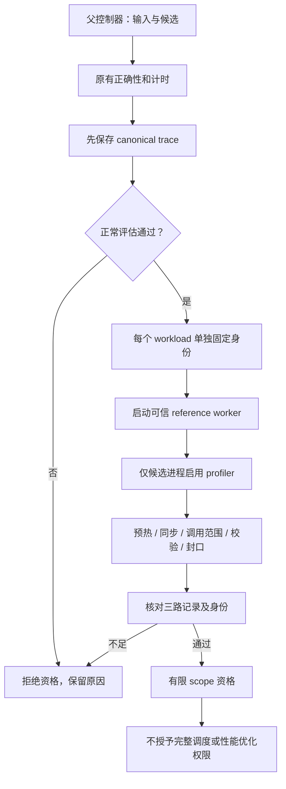

# 生产 evaluate 的 HIP scope 资格检查

2026-10-12。`evaluate --profile rocprofv3-scope` 已接入生产命令。它先运行原有
正确性和计时流程，保存 canonical trace，再为每个 workload 启动独立诊断进程。
不要求手填候选 ID，也不读取旁边已有的 scope 文件来授予资格。

## 使用方式

```bash
ROCR_VISIBLE_DEVICES=GPU-a30fa29c1cca1511 sol-execbench evaluate PROBLEM_DIR \
  --solution SOLUTION.json --profile rocprofv3-scope --trace-output TRACE.jsonl
```

沿用现有容器隔离、GPU 排他锁和 clock owner/borrower 协议。该模式要求核验过的
STABLE_PEAK，覆盖正常评估和重放；目标锁频由外层负责，packager 不再重复申请全卡锁频。
结束和异常路径沿用现有恢复机制：borrower 不抢着恢复，最终由 owner 在容器退出后
恢复并核验 AUTO。没有可核验租约、单个物理 UUID 或持久化输出路径时拒绝启动。

普通 `--profile none`、`rocprofv3` 和 counters 的行为不因旁边存在资格文件而改变。

## 什么条件才算通过

每个 workload 独立执行以下检查，任何一项不足都写 `rejected`。只要有一个拒绝，
本次 CLI 返回失败；canonical trace 中已经完成的正确性、计时结果仍保留，
`all_passed` 表示正常评估，`scope_qualified` 单独表示资格检查。

1. **正常评估通过。** 返回的 definition、solution 和完整 workload 内容须与父控制器
   的请求一致，且恰好对应一条成功 trace。
2. **身份在启动前固定。** 父控制器持有随机 run ID、完整 workload/Solution/Definition
   的 SHA-256、物理 GPU UUID、执行命令、staging 文件、执行器源码和 collector 二进制摘要。
   同名候选换源码会得到不同摘要。子进程 receipt 只用来核对，不能反过来定义预期身份。
3. **真实候选执行。** 使用生产加载器和独立 reference worker；先预热一次，再用新输入执行
   一次被观察的调用。参考输出不传给候选；参考服务验证实际输出。同步、begin/end 和
   seal 由仓库执行器插入，不要求候选自己标记 launch。
4. **trace 完整性。** 整个候选进程的 enqueue、LOSSLESS 完成缓冲和 rocprofv3 导出
   必须逐项一致；显式 launch 和库内 helper 都纳入。不能靠删掉范围外记录缩小分母。
   序号、drop count、正常退出、stop/flush、同步边界、线程、设备和时间范围均须通过。
5. **可支持的因果边。** HIP event 继续使用已验证的 record/wait/queue/enqueue 规则；
   不根据时间接近猜依赖。没有真实 WAIT barrier 的候选不能据此获得事件边资格。

当前支持 Python 候选在本次 capture 中可验证的单进程、单 GPU、单提交线程 eager 路径。
原生编译候选尚未绑定编译产物，明确拒绝；Graph、capture、IPC、异线程或不明确的
事件代次同样拒绝。这里验证的是这一次调用，不证明候选在其他输入或模式下也合格。

## 为什么分成两次运行



profiler 在参考服务就绪后才启用；否则启动器导入 Torch 时也会初始化 SDK。
profiler 自身的输出清理被限制在独立 `trace/` 子目录，不会删除父控制器 intent 或 staging。
这两个生产链差异都有回归用例。重放不调用计时流程、不写正常评估的 timing 文件。

## 实际验收与证据边界

最终正例为同一个 PyTorch GEMM definition，两个规则 shape：`M/K/N=64/64/64`
和 `128/64/64`；两个同名候选分别执行 `A @ B`、`copy_(A)` 后再 `A @ B`。
两次公共 CLI 共四次重放全部合格：纯 GEMM 每次 1 个范围内 dispatch；带拷贝候选每次 2 个，
其中 1 个是 HIP 库内 helper。workload 摘要随 shape 改变；候选摘要随源码改变，
即使名字相同也不会混用。此轮未包含跨流 event 正例，不能用它扩展先前的事件验收范围。

最终 GPU 窗口为
[`attempt-20261012-000246`](../../data/outputs/evaluate-hip-scope-20261011/attempt-20261012-000246/receipt.json)。
同一镜像 `sha256:0ec2e6cba29e673ebe5ad83b7049e5044647fc340174d1c855379efaf36409dd`，
gfx1200，STABLE_PEAK；容器消失后恢复 AUTO，owner 为 restored，排他锁可再次取得。
初次打通记录和各次失败也单独保留，不计入最终正例。

四份原始证据 CPU 重放仍通过；对真实 trace 副本注入 12 类故障并重新计算 SHA，
全部拒绝，包括丢 helper 导出/完成记录、缺 ledger、非零 drop、未封口、身份错配、
错误校验状态和异常退出。详见
[故障重放回执](../../data/outputs/evaluate-hip-scope-20261011/attempt-20261012-000246/fault-replay/receipt.json)。

原来的两个不规则 FP16 workload 在本轮当前代码的 `--profile none` 下也出现数值失败，
资格模式因此拒绝。2026-10-12 的独立排查已将原因定位到 driver 强制开启
`expandable_segments` 所触发的当前 HIP/VMM 数据错误；纯 HIP 程序也能复现。
临时副本仅关闭该设置后，三个原始 workload 连续两次全部通过，容差与逐次验证未改。
随后已将生产默认改为关闭 expandable segments：三个原始不规则尺寸在普通 evaluate 下全部通过，
两个候选的六次 scope 重放全部合格，包含库内隐式 copy dispatch；错误候选在三个尺寸上
仍因数值错误拒绝。具体 runtime/内核故障提交仍未定位。详见
[独立数值失败报告](fp16-evaluate-vmm-diagnosis-2026-10-12.md)与
[生产默认设置验收](evaluate-allocator-default-acceptance-2026-10-12.md)。
这项证据不扩大 scope 资格或性能声明，也没有证明旧栈同样失败。

后续[扩大生产规避验收](evaluate-allocator-expanded-acceptance-2026-10-12.md)覆盖 34 个 workload、
两个 seed，新增 BF16/FP32 matmul、softmax、RMSNorm、行求和以及四种 dtype 的分配与传输探针。
68 份 scope 全部合格，包含 224 个标记为库内隐式的 dispatch；10 组数值错误候选全部拒绝。
68 份真实产物的 CPU 重放与原结果一致，另 50 个语义破坏负例全部拒绝。
这批证据单独归档，继续只授予单进程、单提交线程 eager 范围内的资格，
不把隐式 kernel 的覆盖等同于 DMA 或内存域依赖完整性，也不新增跨流 event 资格。

相关 CPU 回归 **852 passed、1 skipped**；Ruff、格式、ty、耦合、可读性、schema、
文档链接、生产可达性与复用检查全部通过。未重跑全仓库 GPU 测试。
总回执见[report.json](../../data/outputs/evaluate-hip-scope-20261011/report.json)。

原始证据、源码快照、命令、时钟回执、CPU 回归和故障重放保存在未提交的
`data/outputs/evaluate-hip-scope-20261011/`，不混入既有性能对照。

## 第 3 项的关闭口径

| 子目标 | 当前状态 |
| --- | --- |
| SDK 三路完整性检查与 workload 范围绑定 | 已接入，并对真实 production eager 候选验收 |
| 自动绑定 workload 与候选源码身份 | 已验收，包括同名不同实现与多 workload |
| 缺证据保守拒绝、与计时隔离 | 已实现；拒绝同时反映在独立 artifact 和 CLI 状态 |
| 原生编译产物、Graph、任意多线程等执行模式 | 未获资格，继续拒绝 |
| 完整跨 lane 调度、内存域依赖和优化授权 | 未关闭 |

通过只表示现有执行器信任边界内的 capture 覆盖与有限事件边。回调、缓冲和导出仍共享
SDK/runtime，不能排除共同漏报；候选进程 receipt 和可写证据不是抵抗任意恶意候选的
独立安全证明。artifact 固定 `adversarial_attestation=false`、`schedule_complete=false`、
`performance_authority=false`。普通 profile summary 不因该结果自动升级权限。

实现入口：[scope_replay](../../src/sol_execbench/cli/evaluation/scope_replay.py)、
[driver](../../src/sol_execbench/driver/scope_replay.py)、
[资格检查](../../src/sol_execbench/core/bench/rocm_profiler/evaluate_scope.py)。
当前生产 artifact 家族为 `sol_execbench.hip_evaluate_intent.v1`、
`sol_execbench.hip_evaluate_receipt.v1`、`sol_execbench.hip_evaluate_scope.v2`；
复用 `sol_execbench.hip_sdk_ledger.v2`，不改写先前受控探针的证据。
（2026-11-06 L2 线升级：scope/ledger 家族升当前版本并加入复制域与调度完整性，
本文当时记录的旧版本串以 schema registry 为准，不再逐字保留。）
