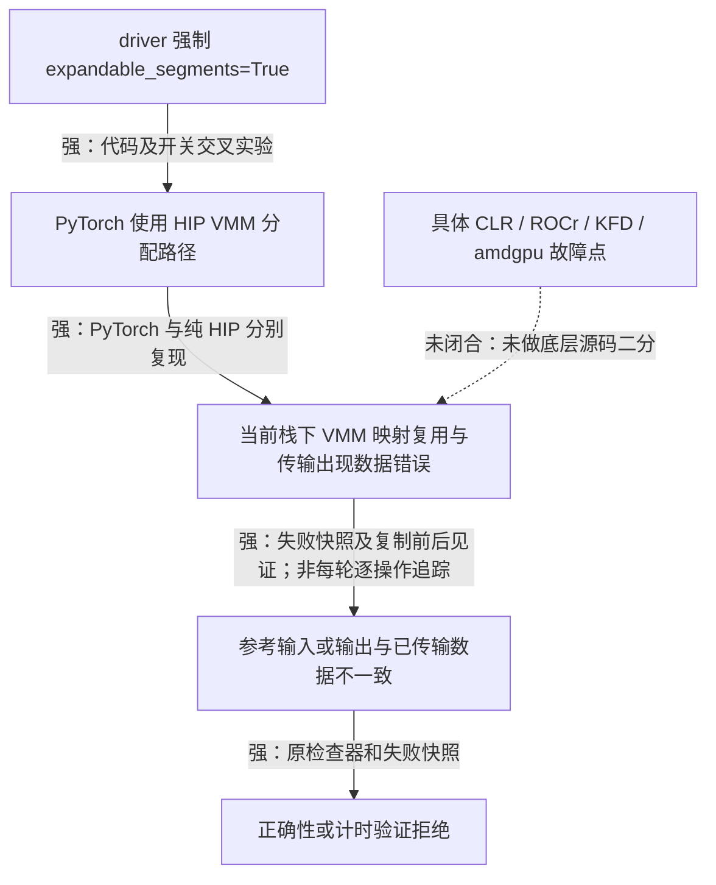

# 普通 evaluate 的 FP16 数值失败：根因在 VMM 路径

2026-10-12。在当前 gfx1200 机器和验证镜像中，普通 evaluate 的不规则 FP16
失败由 **driver 强制开启 `expandable_segments`，进而触发 HIP VMM 路径的数据错误**造成。
候选 GEMM 算错、容差过严和 scope profiler 都不是解释这次失败所必需的条件。

这个结论已经跨过 PyTorch 层：不含 GEMM、IPC 或 driver 的纯 HIP 程序也能复现。
尚未定位到 ROCr、CLR、KFD 或 amdgpu 的具体代码行或提交，不能把这一层的不确定性省略。
本页记录的是定位与临时副本验证。随后同日已将生产默认改为关闭 expandable segments，
普通 evaluate 和 scope 的独立验收均通过；见[生产修复验收](evaluate-allocator-default-acceptance-2026-10-12.md)。
以下保留排查当时的设置、结果和因果边界。新增的 GPU 内部校验、直接 HSA 对照和
本地源码审查见[进一步确认报告](hip-vmm-data-corruption-report-2026-10-12.md)。

## 从症状到原因

起点是同样调用 `torch.matmul(A, B)` 的候选与参考不一致。只运行原问题后两行时，
`359×127 @ 127×211` 在计时验证阶段被拒绝，`1024×333 @ 333×717` 在正确性阶段失败，
最大绝对误差约 48。这个量级无法用普通 FP16 舍入误差解释。

先把检查拆开，单进程计算、同进程序列化往返、跨进程参考服务都通过。
但这些最小程序遗漏了生产路径的一个设置：[环境构造器](../../src/sol_execbench/core/process/environment.py)
排查时无条件写入 `PYTORCH_ALLOC_CONF=expandable_segments:True`，参考和候选进程都会继承它。
外部环境变量也会被这个固定值覆盖。

失败后的快照表明，候选针对收到的输入算得正确；在一次归档样本中，候选对 CPU FP64
计算后舍入至 FP16 的结果最大绝对误差为 0.015625，所有元素仍满足原相对加绝对阈值。
参考结果在线格式中已经全零，接收端准确复原了这些零。正确性检查确实发现了不一致，
但 `REWARD_HACK` 状态本身不能证明候选作弊。

仅靠 `.cpu()` 或 GPU 归约后 `.item()` 的读数，不能判断究竟是 GPU 数据还是下载结果
坏了：两者都经过本次可疑的传输路径。后续实验用普通分配器的常驻 GPU 缓冲区，
先由 GPU kernel 保存源数据，再读回它；这样才获得了复制前后的独立见证。

## 哪些实验改变了判断

下表中的“普通分配”指关闭 expandable segments，不改变计算或正确性阈值。

| 实验 | 结果 | 能说明什么 |
| --- | --- | --- |
| 关闭参考耗时测量 | 原数值失败仍在 | 参考计时不是必要条件 |
| 关闭计时缓存清零；最小服务单独加入 `empty_cache()` | 前者仍失败；后者通过 | 单独归罪于缓存清理不成立 |
| 普通 evaluate 仅改为 `expandable_segments:False` | 原先两行全部通过 | 生产路径有单变量有效干预 |
| 原本通过的最小参考服务开启 expandable segments | 出现数值失败 | 错误能随同一因子迁移到 driver 外 |
| 纯 PyTorch：填值后复制到 CPU，不含 GEMM、IPC | 普通分配 0/210 错；expandable segments 7/210 错 | 无需 GEMM，也不限于 FP16或不规则矩阵 |
| 同一复制程序关闭 SDMA | 仍有 7/210 错 | 关闭 SDMA 不足以解决，不能归为 SDMA 独有问题 |
| 纯 HIP：`hipMalloc` 对照 VMM 映射/解除映射 | 首轮分别 0/140、3/140 错；复核分别 0/700、7/700 错 | 错误跨过 PyTorch，落在当前 HIP/VMM 路径 |

纯 PyTorch 复制覆盖 FP16、FP32、uint8 和七种元素数，包含规则的 65536 元素。
这些失败率只是所列分配/释放顺序下的观测，不是故障概率估计。

纯 HIP 程序使用 `hipMemAddressReserve → hipMemCreate → hipMemMap → hipMemSetAccess`，
由 GPU kernel 填入已知字节，并在每轮结束后 `hipMemUnmap/hipMemRelease`。
普通分配对照执行同样的填充、复制和同步。所有 HIP 调用均检查返回值；两种路径都没有
API 报错。复核的七个错误中，有三个满足：

1. GPU kernel 先把 VMM 源数据复制到 `hipMalloc` 缓冲区，读回完全正确。
2. 对原 VMM 地址执行同步等待完成的 D2H 复制，读回全部错误。
3. 再用 GPU kernel 复制原地址到普通缓冲区，读回也全部错误。

因此至少这些案例涉及源数据在该操作区间内失效，不能只解释成 CPU 输出缓冲区读错。
另四例在首次见证时已经有错误；本轮不把全部错误强行归于同一条内部指令。

## 因果树与证据边界

- **候选计算**：失败样本符合收到的输入，CPU 高精度复核通过；没有证据把这次失败归为 GEMM 算法错误。
- **参考进程传输**：发送端已经带出错误数据；源数据在 VMM 操作区间内也可受损。safetensors 和 IPC 不是触发所必需的条件。
- **driver**：固定开启未在本机通过数据完整性验证的分配模式，是可修改的直接触发点；普通 evaluate 的其余逻辑保留时，关闭它即可通过。
- **底层责任**：定位到当前 HIP/VMM API 路径；仍不能区分 runtime、内核映射/清页或具体同步缺陷。关闭 SDMA无效，额外同步也不能据此证明某个微架构机制。

将问题称为“ROCm 升级引入的回归”仍需旧栈的同一纯 HIP 对照；本轮没有做这个比较。
也不能从一台 gfx1200 的结果推广到所有 GPU、ROCm 版本或 VMM 使用方式。

## 处理方案的回验

在临时源码副本中只把固定分配器设置改成 `expandable_segments:False`，保持
`max_atol=max_rtol=0.00125`、`required_matched_ratio=1.0`、十轮正确性检查和逐次计时验证。
使用全部三个原始 workload，执行“原设置 → 关闭两次 → 恢复原设置”的对照：

| 设置 | w0：1823×781×511 | w1：359×127×211 | w2：1024×333×717 |
| --- | --- | --- | --- |
| 原设置，第 1 次 | PASSED | PASSED | REWARD_HACK |
| 关闭，第 1 次 | PASSED | PASSED | PASSED |
| 关闭，第 2 次 | PASSED | PASSED | PASSED |
| 恢复原设置 | PASSED | PASSED | REWARD_HACK |

两次关闭设置后，六条 trace 的十轮正确性检查最大绝对误差均为零，逐次计时验证也通过。
加入 w0 会改变后续分配/复用顺序，失败位置随之改变；这再次说明它不是某个 shape 必然算错。
各 evaluate 运行保留独立输入 nonce；固定输入的因果对照由复制与纯 HIP 实验补充。

该建议已在后续生产验收中落实。重新开放 expandable segments 前，应先通过
包含释放、重映射和双向传输的数据完整性资格检查。不要通过放宽容差、关闭逐次验证、
忽略参考错误或调整 shape 来绕过。这是待实施建议，不是本轮已经上线的修复。

## 证据和复现

独立目录：`data/outputs/fp16-evaluate-numerics-20261012/`。
[总回执](../../data/outputs/fp16-evaluate-numerics-20261012/report.json)列出全部实验及排除项，
[SHA 清单](../../data/outputs/fp16-evaluate-numerics-20261012/manifest.json)绑定源码、命令、输出、快照和回执。
两个有诊断脚本干扰的早期尝试保留但排除其 CLI 状态：父进程提前初始化 Torch 后超时；
另一次诊断输出误写已关闭的参考 stdout，导致控制管道关闭。

关键记录：

- [候选、参考及线格式快照分析](../../data/outputs/fp16-evaluate-numerics-20261012/attempt-20261012-110839/capture-analysis.json)。
- [复制前后独立见证](../../data/outputs/fp16-evaluate-numerics-20261012/attempt-20261012-112039/localized-copy.json)。
- [全部尺寸回验](../../data/outputs/fp16-evaluate-numerics-20261012/attempt-20261012-112308/live-summary.json)。
- [纯 HIP 回归探针源码](../../data/outputs/fp16-evaluate-numerics-20261012/attempt-20261012-112436/vmm_regression.cpp)和[VMM 运行结果](../../data/outputs/fp16-evaluate-numerics-20261012/attempt-20261012-112436/vmm-cli.json)。默认参数走普通分配，添加 `vmm` 参数走 VMM；数据错误返回 1，HIP API 错误返回 2。

镜像 ID：`sha256:0ec2e6cba29e673ebe5ad83b7049e5044647fc340174d1c855379efaf36409dd`。
Python 3.14.4、PyTorch 2.14.0+rocm10.1.0、HIP 7.16.26385、Linux 7.0.0-38-generic；
GPU 为 gfx1200，BDF `0000:05:00.0`。这是既有验证镜像，不代表未经修改的官方镜像认证。

18 个 GPU 窗口全部使用 UUID 定向 STABLE_PEAK host guard；均在容器退出后恢复并核验
AUTO，owner 为 restored、没有 release blocker，排他锁可重新取得。原始 CLI 自动生成的
计时附件留在本诊断目录，`performance_evidence=false`，不纳入既有性能对照或升级收益。
