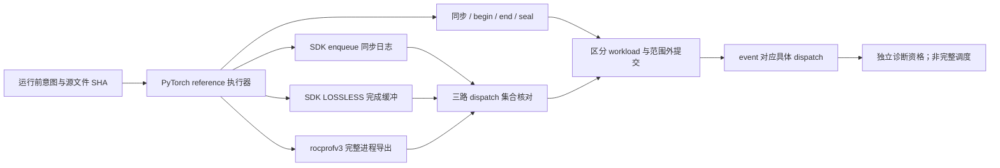

# PyTorch workload 的 HIP trace 范围验收

## 验收目标（实验前约定）

这次验证的是采集证据，不测升级收益。沿用 UUID 定向的 STABLE_PEAK
host guard；独立目录留存原始 trace、采集器日志、运行意图和恢复 AUTO 的证据。

原生探针的应用日志不能枚举 PyTorch 库内部的提交。本次增加 SDK 采集器，
用同步提交回调核对异步完成记录，再与 rocprofv3 的整个进程 trace 核对。
所有 dispatch 都保留，初始化、预热和校验属于范围外活动，不能先过滤后计数。

通过条件：

1. 运行前固定 run ID、workload、源文件和采集器二进制 SHA；运行后核对进程、
   命令、GPU UUID、数值正确性及全部证据 SHA。
2. 采集器从 SDK 初始化持续开启至执行器显式封口，使用 LOSSLESS 缓冲；drop count 为零，
   stop/flush 成功且存在终态。同步 enqueue、独立缓冲完成记录及完整 trace
   的 dispatch 集合严格相等；封口前 HIP API 与 event 记录也核对，重复和缺项均拒绝。
3. 工作范围由执行器显式开始/结束，以设备同步包围。每次提交在提交时记录范围，
   完成时沿用该归属。单线程提交；异线程、嵌套、未闭合范围均不授予资格。
4. 覆盖仓库的 eager GEMM、复合矩阵乘，以及跨 stream 的 PyTorch event 链；
   必须实际观察库内 kernel，也覆盖由内存 API 发出的隐式 helper dispatch。
5. 每种情况至少三次独立进程成功；删掉成对 trace 记录、改范围、改身份、伪造
   丢失计数、缺收尾等故障必须被拒绝。事件边单独核验，不能拿集合完整代替因果关系。

## 第 3 项的关闭条件

“HIP event 到 dispatch 的可信诊断关联”可以按明确支持范围关闭，条件是以上
验收全部通过，解析器可重复重放证据，普通缺证据路径仍返回 partial/unavailable，
且使用者能看到限定范围。不能把三个 workload 的通过外推到任意 PyTorch 程序。

跨 stream 调度预测是更强的目标：还须覆盖全部相关依赖域（内存复制、默认 stream、
Graph、后台线程及跨进程等），并单独验证调度模型。当前第 3 项不以该目标已经达成为前提。
若第 3 项仍包含“任意 PyTorch workload 自动获得完整调度资格”，则不能关闭。

| 关闭门槛 | 本次状态 |
| --- | --- |
| 实际 eager workload，覆盖库内提交及隐式 helper | 已通过，见下表 |
| 记录完整性、workload 范围和事件端点同时核验 | 已通过限定执行器验收 |
| 正例重复、真实 trace 故障副本、CPU 回归 | 已通过，证据单独归档 |
| 普通证据不足时不自动升级权限 | 保持 partial；本次资格是单独 sidecar |
| 生产 evaluate 的受控 eager 范围 | 后续已接入验收，见[生产报告](evaluate-hip-scope-acceptance.md) |
| compile / Graph / 多线程路径自动取得资格 | 未完成，继续拒绝 |
| 完整跨 lane 调度与优化预测 | 未关闭；仍需其他依赖域与模型验收 |

因此，第 3 项的**受控 eager 诊断子项可以关闭**。若按此前“完整跨 lane
调度资格”的总目标跟踪，第 3 项整体仍未关闭。不能用本文的诊断资格替代调度资格。

SDK 提交回调和缓冲记录共享底层 runtime，能够发现导出、范围绑定和缓冲丢失问题，
不能排除 SDK/runtime 在两个通道上同时漏报。这是证据边界，不是已证明不存在的风险。

## 实测结果（2026-10-11）

固定验证镜像为 `sha256:0ec2e6cba29e673ebe5ad83b7049e5044647fc340174d1c855379efaf36409dd`，
目标是 gfx1200 / `GPU-a30fa29c1cca1511`。调用仓库已有的两个 reference：
`l1n8_matmul_irregular` 的 `A @ B`，以及 `3267_doubled_matmul` 的 `a @ (b + b)`。
event 用例在后者上增加 producer RECORD、consumer WAIT 和乘二操作。
各用例在工作范围内先做连续张量复制，以覆盖 HIP 内部复制 kernel。

| 每个独立进程 | shape（M/K/N） | 整个 capture 的 dispatch | workload 内 | 范围外 | workload 内部 helper | 闭合事件边 | 重复数 |
| --- | --- | ---: | ---: | ---: | ---: | ---: | ---: |
| FP16 eager GEMM | 513/1025/255 | 8 | 4 | 4 | 3 | 0 | 3 |
| FP32 eager 复合矩阵乘 | 513/1025/255 | 11 | 5 | 6 | 3 | 0 | 3 |
| FP32 eager 复合矩阵乘 + 跨流 event | 4096/4096/4096 | 12 | 6 | 6 | 3 | 1 | 3 |

共核对 **93 个 dispatch**，其中 **45 个属于 workload，48 个属于初始化、预热或校验**。
workload 中包括 **27 个内部 helper**，三次 event 用例共闭合 **3 条边**。
每次均通过 CPU reference 数值检查；采集器 drop count 为零，显式 stop/flush 成功。
这些是覆盖数量，不是性能结果。范围外 dispatch 原样保留，未从分母删除。

23 种真实 trace 副本故障全部被拒绝，涵盖成对删除 helper/launch/event、删除回调或
完成记录、重复 dispatch、改范围、缺 end/终态、非零 drop count、flush 失败、身份和
源文件错绑、越过完成边界、缺同步、event 参数/源队列/时间戳冲突及陈旧 SHA。
其中两个双通道丢失用例还修复了副本的序号与计数，仍被第三通道的集合核对拒绝。
除陈旧 SHA 用例外，故障副本均重新计算 SHA，验证的是语义拒绝能力。
本次相关 CPU 回归为 **673 passed**；Ruff、格式、ty、耦合、可读性、schema、
当前文档、生产可达性和复用检查全部通过。未重跑全仓库 GPU 测试。

## 实际接入中发现的边界

1. **不能在 SDK 的工具析构回调里才停止 context。** 首次尝试在该时刻收到
   `CONTEXT_NOT_FOUND`。执行器现于最后一次同步后显式 stop/flush，再写封口记录；
   SDK finalize 检查已封口，控制器另要求正常进程退出。封口之后的少量解释器清理
   API 不在独立 API 日志覆盖范围内，只允许审计过的清理/查询集合；整个进程的
   dispatch 仍须与日志完全相等，任何封口后的额外 kernel 都拒绝。
2. **复合矩阵乘的初始化本身会产生约 9.2 万条 HIP API 记录。** 这条 opt-in 路径使用
   10 万条日志、64 MiB 单文件上限，越界即拒绝。普通因果摘要仍保留原 1 万条组合记录
   上限，没有因为此实验扩大普通摘要的资格范围。
3. **内部 helper 的 stream 字段可能为 0。** 原值照存，以已核验的 queue 与提交顺序
   绑定范围；不将 0 自动解释成默认流同步关系。
4. **小矩阵的 WAIT 没有产生 GPU barrier。** 原来的小矩阵 event 用例三次均观察到
   RECORD 和 host WAIT，却没有 WAIT enqueue/完成记录，均以 `hip_scope_barrier_mismatch`
   拒绝。它与等待时工作已完成的语义相容；此处不宣称已证明 runtime 内部选择了哪条分支。
   改用大矩阵后，三次都观察到真实 WAIT barrier 并闭合边。原样保留小矩阵负例。

支持范围是单进程、单 GPU、单主机提交线程、eager、非重叠 HIP 调用、每个 event
在范围内只记录一次；嵌套范围、异线程、Graph、捕获、IPC 和不明生成均拒绝。
显式 begin/end 属于经过审计的执行器，不允许任意候选自报日志就获得资格。
内存 helper 的**dispatch 归属**已验证，内存复制域的全部**依赖关系**并未验证。

## 实现与证据

- 控制器：[torch_scope.py](../../scripts/internal/upgrade/torch_scope.py)。通过已有
  `collect_rocprofv3_profile` 采集，借用 host guard 的锁和 STABLE_PEAK 窗口；
  新运行在采集后自动调用资格检查并写 `scope.json`。
- 执行器与 SDK tool：[torch_scope_workload.py](../../scripts/internal/upgrade/torch_scope_workload.py)、
  [scope_collector.cpp](../../src/sol_execbench/core/bench/rocm_profiler/scope_collector.cpp)。
- 生产检查入口：[qualify_torch_scope](../../src/sol_execbench/core/bench/rocm_profiler/hip_torch_scope.py)，
  当前 artifact 为 `sol_execbench.hip_sdk_ledger.v1` / `sol_execbench.hip_torch_scope.v1`。
  普通 profile summary 不会因旁边存在该文件而自动提升权限。
- [GEMM/复合采集及小矩阵负例](../../data/outputs/hip-torch-scope-20261011/attempt-20261011-223916/receipt.json)、
  [大矩阵 event 补采](../../data/outputs/hip-torch-scope-20261011/attempt-20261011-224341/receipt.json)、
  [最终重放与故障注入回执](../../data/outputs/hip-torch-scope-20261011/final-replay/receipt.json)、
  [双通道丢失补充回执](../../data/outputs/hip-torch-scope-20261011/channel-faults/receipt.json)。
  每次 host guard 均验证容器退出后恢复 AUTO，owner 为 restored，GPU 锁可重新取得。
- 前两次失败（退出时机、条数上限）也保留在同一独立根目录；不计入正例。
  采集时源文件另有快照，格式整理后的当前源码不会冒充当时的 SHA。

完整原始证据位于未提交 `data/outputs/hip-torch-scope-20261011/`，不并入现有性能对照。

## 生产接入后续（2026-10-12）

通用 `evaluate` 已增加 `--profile rocprofv3-scope`，自动按 workload 和候选源码绑定，
缺证据返回拒绝；生产 eager 范围的正例及剩余边界见
[生产接入验收](evaluate-hip-scope-acceptance.md)。本文较早记录的“未接入生产”只描述
当时检查点，不再代表当前实现。完整跨 lane 调度仍未关闭。
