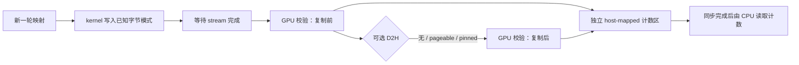
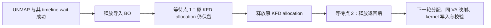
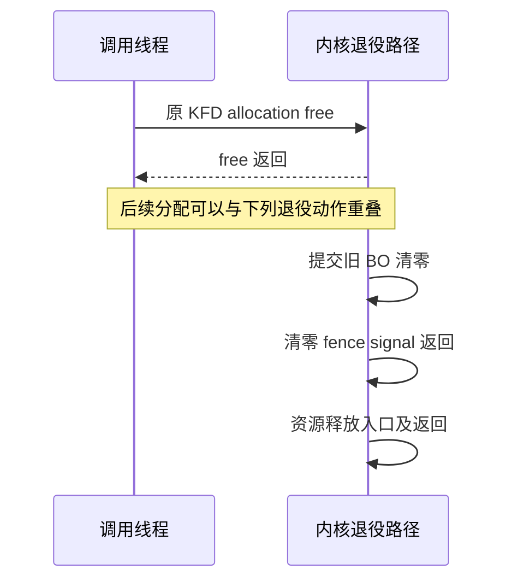
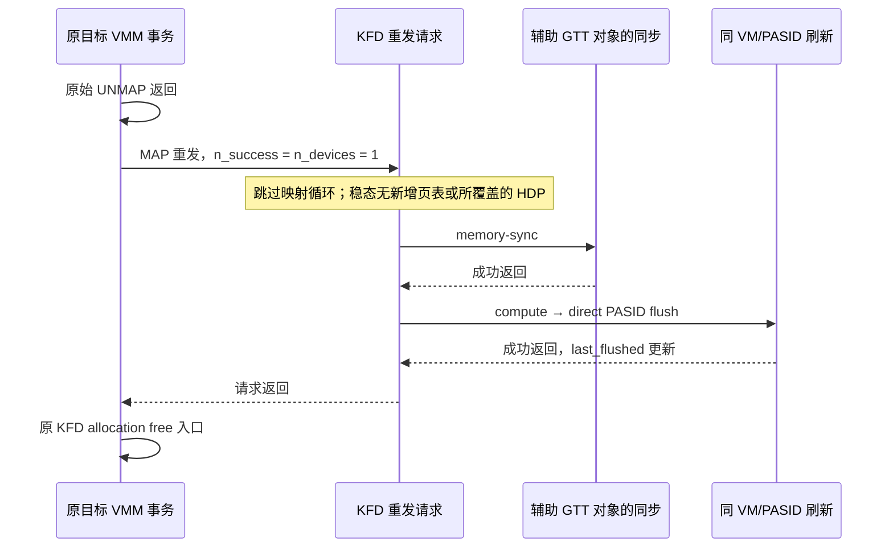

# 从 FP16 数值失败追到 VMM 地址复用：一次 GPU 数据完整性排查

2026-10-12。本文隐去背景项目名称，讨论一个 GPU 评估系统中发现的数据错误。

**在当前 gfx1200 验证环境中，数据完整性缺陷已经独立复现。最有区分力的触发组合是：
解除旧映射后，把同一个虚拟地址映射到新创建的物理内存 handle。**
纯 HIP 可以触发；绕过 HIP 的 VMM 管理、直接调用 HSA VMM 也可以触发。
测试中的所有相关 API 都返回成功，GPU 内部校验却发现刚写入的数据不符合预期。

这比“PyTorch 分配器可能有问题”更明确，也还没到“某个 AMD 提交写错了”的程度。
目前确认的是当前 AMD VMM 路径的数据完整性缺陷，以及能改变结果的几个因子；
ROCr、内核、固件和硬件之间的具体责任仍未划分。

后续已将实际 ROCr 二进制绑定到准确源码，并用重建基线复现。单变量干预进一步发现：
**相同的 1 ms 等待，放在原 KFD allocation 释放前仍会失败，放在释放返回后则本轮未触发。**
实际 MAP/UNMAP 的 timeline wait 和 KFD free ioctl 都成功返回。现在能定位关键时序边界，
仍不能把“加等待有效”写成某个释放函数或硬件单元已经被证明有错。

无告警内核追踪进一步确认：旧 BO 清零 fence 完成后才释放资源；VMM 循环内失效序号增加，
却未捕获所覆盖的直接 PASID flush。释放前补一次标准 KFD 映射，本轮 0/2100，
同位置等待 1 ms 仍有 11/2100。这把优先假说推向地址翻译失效的衔接；
额外映射的实际刷新已逐轮确认。进一步用 KFD 重发跳过映射步骤，本轮仍为 0/2100，
额外 GEM_VA 更新却仍有 13/2100。最新内核追踪又确认：重发组在第 2–700 轮没有新增页表更新或
所覆盖的 HDP 调用，每轮确有释放前 PASID 刷新。故障解释进一步收敛到 KFD 同步/刷新尾部；
同步、锁和刷新自身尚未拆开，仍不能归责到某条语句。

最新又做了设备选择对照：同一辅助对象预先映射到两张 AMD 卡，重发时只改变请求中的设备 ID。
两批选择目标卡各为 0/2100；选择另一张卡分别有 29/2100、13/2100 次错误，后者再加 1 ms 等待
仍有 16/2100。因此，同一辅助对象的同步和主要共享锁路径不足以解释目标组的效果。
新追踪已补齐这条内部调用边：目标组 2097 个稳态轮次都执行了目标 VM/设备的直接刷新；
另外两组共 4194 个稳态轮次则在另一 VM 上因序号相等直接返回，没有执行 direct flush。
追踪下目标组仍为 0/2100，另一设备及其加等待组分别有 22/2100、13/2100 次错误。
这把重点进一步收敛到目标 VM 的刷新相关路径，但仍不能写成“纯刷新已修复”。

## 1. 为什么最初看起来像矩阵乘算错了

升级后的评估系统在不规则 FP16 矩阵乘上出现数值失败，有时又表现为逐次计时校验失败。
最初有三个嫌疑：候选计算错误、参考进程的数据传输错误、评估驱动自身有问题。

此前的排查发现，候选输出能通过原有精度标准，参考结果却可能在传输之前就读成错误数据。
进一步去掉矩阵乘、参考服务和 IPC，只保留填值与复制，仍可复现。
生产驱动当时固定开启 `expandable_segments`；仅关闭它，三个原始 workload 就恢复通过。
整个过程中没有放宽容差或取消逐次验证。

这些证据建立了“开启该分配模式会触发错误”，还不能充分回答两个问题：
CPU 读回是否可信？错误究竟需要复制，还是只要复用映射就会出现？
本轮实验集中补齐这两点。此前结果见[初次定位报告](fp16-evaluate-vmm-diagnosis-2026-10-12.md)，
生产规避及普通 evaluate/scope 验收见[独立验收报告](evaluate-allocator-default-acceptance-2026-10-12.md)。

## 2. 先确认原复现仍然有效

原纯 HIP 探针依次完成：分配、kernel 填值、GPU 拷贝到普通分配的见证缓冲区、
直接复制到 CPU、再次 GPU 见证，最后释放。每个阶段显式等待 stream 完成。
VMM 版本每轮在同一地址建立新的映射；普通版本使用 `hipMalloc`。

每个进程覆盖七种有效字节数，每种执行 100 轮。三次独立进程的结果如下：

| 分配方式 | 第一次 | 第二次 | 第三次 | 合计 |
| --- | ---: | ---: | ---: | ---: |
| 普通 `hipMalloc` | 0/700 | 0/700 | 0/700 | 0/2100 |
| VMM，同地址、重新创建 handle | 5/700 | 2/700 | 8/700 | 15/2100 |

表中分子是至少一个校验阶段失败的轮数，不是错误字节数。
三次 VMM 进程都能触发，普通分配对照全部通过。部分轮次在直接 D2H 前通过、之后失败。
这确认了复现仍有效，但原见证仍要复制回 CPU，因此需要第二种观察方法。

## 3. 用 GPU 内部校验拆开复制与映射

新探针不再把目标缓冲区复制到 CPU 后才判断对错。GPU 校验 kernel 在设备上比较每个字节，
把分块错误计数写到**另一块 coherent host-mapped 内存**。CPU 等待 stream 完成后读取计数。
这条计数通道仍依赖 GPU/runtime 的一致性保证，但不再对被测 VMM 数据调用 D2H 复制。

填充值由字节位置和迭代编号共同生成，避免全零或单一常量掩盖错误。每轮都先填值，
再做一次 GPU 校验；执行可选复制后，再校验一次。所有 launch 错误和同步返回值均检查。

对照有两组自变量：

- 映射方式：普通分配；同地址换新 handle；每轮使用新地址；保持同一映射。
- 目标数据的复制方式：完全不复制；复制到 pageable 主机内存；复制到 pinned 主机内存。

每种组合运行两个独立进程，各 700 轮：

| 分配/映射方式 | 无 D2H | pageable D2H | pinned D2H |
| --- | ---: | ---: | ---: |
| 普通分配 | 0/1400 | 0/1400 | 0/1400 |
| 同地址，每轮创建新 handle | **7/1400** | **15/1400** | 0/1400 |
| 每轮使用从未映射过的新地址 | 0/1400 | 0/1400 | 0/1400 |
| 保持同一映射与 handle | 0/1400 | 0/1400 | 0/1400 |

最关键的结果是 **没有目标 D2H 复制也会失败**。这排除了“必须由 pageable 复制触发”
和“只有 CPU 读回值错误”这两种解释。它证明 GPU 可观察的数据完整性出了问题，
但尚不能区分物理内容被覆盖、写入落错位置、地址翻译异常或缓存可见性异常。

pinned 组合在本轮没有触发，但不能据此宣布 pinned 是修复。其分配、释放和复制路径
都会改变系统活动；无复制组合已经证明错误不依赖 pageable D2H。

## 4. 排除地址布局差异，再区分物理 handle 的作用

上一组中，“新地址”需要预留更大的虚拟地址区间，存在一个干扰因素：
结果可能来自预留布局，而不只是地址是否复用。

因此又做了两项对照，全部关闭目标 D2H：
一是让“复用地址”和“新地址”预留同样大的区间；二是仍然反复 unmap/map，
但保留同一个物理 handle，不再每轮 release/create。

| 条件 | 三次进程结果 | 合计 |
| --- | --- | ---: |
| 大预留区间，同地址，每轮创建新 handle | 3、4、2 次失败 | **9/2100** |
| 同样大的预留区间，每轮新地址、新 handle | 全部通过 | 0/2100 |
| 同地址反复 unmap/map，保留同一 handle | 全部通过 | 0/2100 |

因此，预留区间大小不足以解释结果；在当前探针覆盖范围内，单独执行 unmap/map 也不足以触发。
证据更具体地指向**同一地址与新创建物理 handle 的组合**。

这里的“新 handle”指新的 API 分配对象，不保证底层每次给出不同物理页。
实验没有观测真实物理页号，不能把它写成已证明的物理页替换机制。

## 5. 绕过 HIP 的 VMM 管理，直接调用 HSA

为了区分 HIP/CLR 的 VMM 管理和更底层的实现，下一组保持相同 kernel、数据模式和观察方式，
把 reserve/create/map/set-access/unmap/release 全部改为 `hsa_amd_vmem_*`。
程序明确选择唯一可见 GPU 的可分配 coarse-grained 内存池，按该池粒度对齐。
目标缓冲区不再经过 HIP 的 VMM 对象管理，也不进行 D2H。

| 直接 HSA VMM 的条件 | 三次进程结果 | 合计 |
| --- | --- | ---: |
| 同地址，每轮创建新 handle | 9、5、3 次失败 | **17/2100** |
| 每轮新地址、新 handle | 全部通过 | 0/2100 |
| 同地址反复映射，保留同一 handle | 全部通过 | 0/2100 |

这排除了“必须经过 HIP/CLR VMM 管理才能触发”的解释，把必要排查范围推进到
ROCr VMM 及其下层。**它不是完全无 HIP 的程序**：kernel 提交、stream 同步和独立计数区
仍使用 HIP。不能据此排除所有 HIP 执行代码，更不能只凭这组对照指认内核或硬件。

## 6. 用准确源码重建，再做单变量干预

### 6.1 先解决源码与二进制是否对应

初次审查使用本地 HEAD `def8746b6…`，只用于理解调用链，不能代表镜像中的库。
后续在镜像里找到 TheRock 构建清单：`rocm-systems` 固定为
`7da43026e4f2ef7600433c38c820732f7a205d22`，该子模块没有额外 patch。
原 ROCr 库同时包含 `ROCR BUILD ID: "1.21.0-local-build-7da43026"`。
两份独立标识一致，补齐了生产者声明的版本绑定。完整清单、原库摘要和反汇编分别归档。

从这个提交导出 ROCr 源码，在原镜像内重建，沿用镜像的 libdrm 等依赖。
使用 Release 配置，关闭未用到的 image API 支持；没有尝试逐字节复制供应商构建。
因此这是一份**准确源码版本的行为对照**，不是供应商二进制的可重复构建证明。
重建后逐文件核验 783 份源码与该提交一致；本地原源码 checkout 保持干净。

每个实验进程都记录 `/proc/self/maps`，核对实际加载的 ROCr 路径和 SHA-256。
原库、重建基线和每个变体分别保存。变体复用构建目录，但穿插对照始终加载另存的基线库，
不会把上一次构建产物误当基线。仅替换 ROCr，HIP、探针、设备、依赖与时钟策略保持相同。

先运行原库与重建库，各三个进程，每个进程 700 轮：

| 条件 | 原库 | 重建基线 |
| --- | ---: | ---: |
| 同地址、新 handle | 17/2100 | 24/2100 |
| 每轮新地址 | 0/2100 | 0/2100 |
| 同地址、保留同 handle | 0/2100 | 0/2100 |

重建基线能够复现同样的触发组合，满足了后续源码干预的前提。
其三个复用进程分别有 10、0、14 次错误，也说明单个进程未触发不能作为通过结论。
[基线回执](../../data/outputs/hip-vmm-source-binding-20261012/attempt-20261012-122636/receipt.json)

### 6.2 先区分属性、操作与时序

下面所有干预都在上述提交的同一构建配置中完成，每个变体只改变一个行为点。
每轮三个独立进程，使用同地址、新 handle、无目标 D2H 的探针；基线在变体之间穿插执行。
源码 diff、变体库摘要、编译日志和实际加载证明均保留。

| 单变量干预 | 错误轮数 | 能支持的判断 |
| --- | ---: | --- |
| VMM 物理分配加 `AllocateUncached` | 52/2100 | 这个属性开关不足以消除错误；不能排除所有缓存因素 |
| 底层 `UNMAP` 改为 `CLEAR` | 22/2100 | 仅替换解除映射操作不足以消除错误 |
| MAP 的 timeline wait 成功后等 1 ms | 0/2100 | 错误对时序敏感；等待位置还需要对照 |
| 穿插重建基线 | 58/8400 | 同一窗口中复现能力仍在 |

随后给 MAP 前、handle 创建后和 UNMAP 后分别加相同等待：

| 等待位置 | 错误轮数 |
| --- | ---: |
| MAP ioctl 发出前 | 0/2100 |
| handle 创建完成后 | 0/2100 |
| UNMAP 的 timeline wait 成功后、release 前 | **16/2100** |
| MAP 的 timeline wait 成功后 | 0/2100 |
| 穿插重建基线 | 58/8400 |

因此，最初“MAP 返回时还有动作没有完成”的猜想过窄：在 MAP 发出前等也有效。
UNMAP 后等却无效，说明不能把结果简单解释为“任意位置慢一点就行”。
这里的 1 ms 是 `usleep(1000)` 的请求时长，没有测定调度后的实际等待时间。

### 6.3 源码中的等待确实执行了，但 BO idle 等待没有解决错误

准确版本的调用链如下：

| 层次 | 源码入口 | 已核查的行为 |
| --- | --- | --- |
| ROCr | `runtime.cpp` 的 `VMemoryHandleCreate/Map/Unmap/Release` | 管理分配、权限、映射与 handle 生命周期 |
| driver 封装 | `amd_kfd_driver.cpp` 的 `Map/Unmap` | 调用 `hsaKmtMemoryVaMap/Unmap` |
| thunk | `libhsakmt/src/memory.c:1122–1239` | 发出 GEM_VA MAP/UNMAP，并等待对应 timeline syncobj |
| 原 KFD allocation 释放 | `amd_kfd_driver.cpp:745–763` → `hsaKmtFreeMemory` | 先释放导入 BO，再释放保留的原 KFD allocation |
| thunk 的最终释放 | `libhsakmt/src/fmm.c:2243–2324` | 发出 KFD free ioctl，释放 bookkeeping 对象 |

原库反汇编中已经能看到 timeline wait。为了确认实际参数与返回值，又用轻量观察器拦截
libdrm 调用，在进程退出时写汇总，不在每次调用时写日志。
原库和重建库各三个进程，每个进程的 700 次 MAP、700 次 UNMAP，都匹配了随后的等待：
同一 fd、syncobj handle 和 timeline point，单 handle、`WAIT_FOR_SUBMIT`，返回值全部为零。
原库仍出现 20/2100 次错误，重建库为 16/2100。
这排除了“实际二进制漏掉了源码中的等待”，不证明等待已覆盖所有所需状态。

另在 MAP 前加入 `amdgpu_bo_wait_for_idle`，以无限超时等待且要求返回不 busy；
设零超时查询为对照。等待版仍有 17/2100 次错误，查询版为 21/2100，
穿插基线为 45/6300。**这个 BO idle 检查也不是有效修复。**
它不能排除未被这个接口表达的下层操作，更不能证明根因与任何 fence 都无关。

### 6.4 把等待继续移到释放步骤之间

接下来先比较 `VMemoryHandleCreate` 中 `region->Allocate` 前后加等待。
两者分别为 0/2100，穿插基线 59/6300。
分配前就有效，说明不必先创建新 allocation 再等待，也削弱了“只由新分配初始化不完整导致”的解释。

更有区分力的对照在 `KfdDriver::DestroyMemoryHandle` 中：

两个等待点是**不同变体**，不会在同一进程同时加等待。

| 等待位置 | 三次进程的错误轮数 | 合计 |
| --- | --- | ---: |
| 导入 BO 释放后、原 KFD allocation 释放前 | 1、2、2 | **5/2100** |
| 原 KFD allocation 释放返回后 | 0、0、0 | **0/2100** |
| 穿插重建基线 | 6、3、5、4、3、6、5、6、7 | **45/6300** |

准确版本已经保留原 KFD allocation 直到销毁；不是缺少这个保留动作。
该设计的源码注释涉及 KFD eviction fence 与迁移后的映射维护，属于设计背景，
不能直接当成本例的故障解释。

最后又观察重建基线的实际 KFD free ioctl。三个进程的每个 UNMAP 等待之后，都观察到一项
成功返回的 KFD free 请求：各 700 次，无丢失或失败，数据错误仍为 19/2100。
观察器验证的是该探针的调用顺序与返回状态，没有取得物理页号或内核完成事件。

**现在最窄的实证边界是：原 KFD allocation 释放返回后，到下一轮同 VA、新 handle 使用之间，
存在影响复现的时序因素。** 给这个窗口额外时间，本轮不再触发；在释放前等相同时间仍能触发。
这比“ROCr 以下可能有问题”更具体，但“延时位置定位”仍不是“责任语句定位”：
不能据此断言 `hsaKmtFreeMemory` 的 ioctl 实现写错了，或已经证明存在未完成的 TLB 失效。

各组保留独立分母，不合并成总体故障率。干预结果是数据完整性诊断，不是性能对照；
也没有把等待补丁、uncached 或 CLEAR 变体部署到生产。

### 6.5 绑定正在运行的内核，区分已有保护与待验证关系

后续已把正在运行的模块绑定到 Ubuntu 的准确发行源码版本：

| 标识 | 核验结果 |
| --- | --- |
| 内核发行包 / 上游版本 | `linux 7.0.0-38.38` / `7.0.14` |
| 运行内核 GNU Build ID | `338e542e384c46228f7a378babc0f9bb2b6a5997` |
| 运行与磁盘 amdgpu GNU Build ID | 均为 `3851d805e795c93056112ef2d338c331c42767ae` |
| amdgpu srcversion | `9BDBC866F55BF296F1B7FA2`，运行与磁盘一致 |
| 模块包归属 | `linux-modules-7.0.0-38-generic`，该模块文件匹配包内校验值 |
| 官方 Git 发布 tag | `Ubuntu-7.0.0-38.38`，指向 `740b32353f43e9b00d0350d6fa7b29a6667deabd` |

从 Ubuntu 官方 HTTPS archive 下载这个版本的 `.dsc`、原始源码和发行补丁，
核验两份归档的 SHA-256 后完整解包并应用补丁；发行 changelog 首项版本一致。
这是发行包、运行模块、准确源码包的对应证据，尚未做模块逐字重建或 Git 全树逐文件验证。
`.dsc` 的签名公钥不在本地 keyring 中，因此保留“签名未验证”的边界，不声称完成了 GPG 认证。
[官方源码描述文件](https://archive.ubuntu.com/ubuntu/pool/main/l/linux/linux_7.0.0-38.38.dsc)

这份源码提供了三条重要约束：

- KFD free 经 `kfd_ioctl_free_memory_of_gpu` 进入 `amdgpu_amdkfd_gpuvm_free_memory_of_gpu`，
  拆除附件、放下 BO 引用并返回。`amdgpu_vm_bo_del` 会把有效映射放到 `vm->freed`，
  后续由 `amdgpu_vm_clear_freed` 更新页表。不能仅凭这些函数名判断探针的释放时真的存在待清映射。
- compute VM 明确设置 `need_tlb_fence=true`。TLB fence worker 会等待依赖，执行 PASID flush，
  然后 signal。**源码不是只有页表写入 fence、完全没有 TLB 完成机制。**
- TTM 在相关 BOOKKEEP fence 未完成时，可以延迟销毁；其 worker 会等待这些 fence 后释放资源。
  因此“free 返回不等于 BO 已物理销毁”可能是正常设计，不能直接当作本例的缺陷。

真正需要追踪的是这些保护与当前事务的关系：MAP/UNMAP 导出的 fence 是否覆盖了最后一项相关工作；
KFD free 返回后是否仍有影响下一轮的退役动作；资源的释放与后续分配是否承接了所需依赖。
源码和匹配模块反汇编用于选追踪点，不能替代这些动态观察。

已依据运行内核及模块的 BTF 核验十二项所需函数的存在和参数布局，准备了只观察的 bpftrace 程序。
它关联 allocation/BO、VM/PASID、fence、TLB worker 和 TTM 释放事件，固定运行 45 秒；
配套 runner 先核验当前 Build ID，再执行不运行 workload 的 dry-run，检查编译、BPF 校验和探针附加；
预检通过且正式追踪成功启动后，才运行三个 STABLE_PEAK 基线进程。
详细资格条件见[追踪验收说明](../../data/outputs/hip-vmm-kernel-retirement-20261012/trace-acceptance.md)。

首次终端采集
`trace-window-20261012-130927` 在解析阶段失败：空指针判断中的 `?*` 被识别为路径语法。
归档回执为 `failed_before_gpu`、`gpu_started=false`，未进入锁频或 GPU 实验。
已将四处写法改成显式 `if` 判断，并增加独立 dry-run 门槛；原失败归档保留不变。

### 6.6 首批内核 trace：确认退役重叠，发现需要追踪的另一条路径

随后 `trace-window-20261012-131923` 通过 dry-run 并正常结束，三个基线进程分别出现
4/700、2/700、5/700 次损坏。实际加载的 ROCr 仍是冻结重建基线，PID 关联和时钟恢复均通过。
这是新增的动态观察，不是底层修复实验，也不计入升级收益。

按 allocation 编号、BO/resource 身份和 BO 地址再次分配的时间界限关联事件后，得到：

| 观察 | 本批结果 | 能说明什么 |
| --- | --- | --- |
| 目标分配与释放 | 2100 次分配，各有一次范围内成功的 KFD free | 每轮释放调用确实返回；原始日志中另有 7 次额外 free，不应混入目标分母 |
| 旧资源释放入口与下一轮分配 | 2097 次相邻轮次中，2094 次释放入口更晚 | KFD free 返回后，旧资源仍有退役工作；尚未证明物理页已被复用 |
| 损坏轮次 | 11 次的前一轮资源释放入口都晚于本轮分配，间隔约 59–85 µs | 损坏发生在这个重叠窗口，但大量正确轮次也重叠，因此不能据此认定因果 |
| 页表更新与导出 fence | 4200 次 MAP/UNMAP 都为 CPU 更新；返回同一 fence，context/seq 为 0，SIGNALED 位已置位 | 当前导出 fence 不提供各事务独立的完成时间；成功等待不等于已单独观测到相应 TLB flush 完成 |
| TLB worker | 未捕获该路径的创建或执行事件 | 不能解释为没有任何 TLB flush：原探针只记录 worker 内的 flush，未覆盖直接调用 |

CPU 更新路径解释了为什么要调整追踪设计：`amdgpu_vm_cpu_commit` 直接写入后的屏障及
HDP flush 不生成新的页表更新 fence；`amdgpu_vm_tlb_flush` 在输入 fence 为空时先更新序号并返回，
不会走后面的 TLB fence 创建分支。这与本批现象相容，但尚未逐次记录该条件分支。
需要继续观察 CPU commit 的 `needs_flush`、序号变化和直接 PASID flush，而不是把 worker 的零计数当作缺陷。

另一个需要覆盖的分支是旧 VRAM 清零。KFD 的 VRAM 分配源码设置 `WIPE_ON_RELEASE`；
`amdgpu_bo_release_notify` 提交 `amdgpu_fill_buffer` 清零任务，并把 fence 加入 reservation。
TTM 延迟删除会等待 BOOKKEEP 范围中的 fence 后才释放资源。这些是**现有保护**，
不能从“释放时会清零”直接推断它覆盖了新数据。下一轮要记录清零任务的 BO、job ID、fence
身份和完成状态，再检查与资源释放、下一轮使用的关系。

本批有 18425 条 map key 不存在的运行时告警，以及 `delete` 返回值未使用的编译告警。
它们没有报告 probe-read 错误，但增加了未量化的观察开销；BO 地址标签未及时清理也产生额外事件。
因此保留上述范围内的描述性观察，**不将整批标为完成关系或因果验收通过**。
后续探针改用 key 存在检查、明确的 mem/BO 生命周期和资源释放返回探针，并补上 CPU、直接 flush、
清零 fence 观察；未知告警会阻止验收。新一批采集与验收结果见下一节。

逐代关联和输入摘要见[内核 trace 分析](../../data/outputs/hip-vmm-kernel-retirement-20261012/trace-window-20261012-131923-analysis/report.json)。

### 6.7 无告警的追踪：清零有保护，页表序号与直接刷新尚未衔接

`trace-window-20261012-133824` 的 dry-run、正式附加和追踪均通过，两个预检日志和运行时错误日志为空，
未报告丢事件或读取错误。三个冻结重建基线进程仍有 4/700、6/700、2/700 次损坏，共 **12/2100**。
目标设备保持 STABLE_PEAK；容器退出后恢复并核验 AUTO、设备空闲及锁可重新取得。
因此，本批可以接受为所覆盖事件的结构观察，仍不能直接判定责任代码。

这次逐轮关联了旧 allocation 的 BO、清零 job、fence context/seq 和资源释放返回：

| 需要核查的关系 | 观察结果 | 判断边界 |
| --- | --- | --- |
| 清零是否先于资源释放完成 | 2100 轮都先有清零 fence 的 signal 返回，再进入资源释放；无反例 | 支持现有 fence 保护确实执行；软件 signal 不是独立的 SDMA 硬件完成测量 |
| 退役是否越过下一轮分配 | 2097 对相邻轮次中，2094 对的旧资源释放返回晚于下一轮分配 | 确认退役重叠；没有取得物理页身份，不能声称同一页被提前复用 |
| 旧清零与损坏是否重叠 | 12 个损坏轮次中，前一轮清零完成都晚于当前 MAP 返回，差约 52–212 µs | 相容于旧翻译仍能访问退役内存的猜想；未记录填值/校验 dispatch 时刻，也未直接观察错误物理访问 |
| 页表更新后的失效序号 | CPU commit/HDP 调用均成功，目标循环内序号持续增加；各进程最后一次采样为 1399，`last_flushed` 为 0 | 更新被计入失效序号，但这一采样路径没有显示刷新跟进；1399 是采样值，不是整个 UNMAP 后的最终值 |
| 直接 PASID flush | 目标 700 轮循环内，所覆盖函数调用为零；退出阶段各有 15 次，共 45 次，均成功返回 | 不再受“只观察 TLB worker”限制；仍未排除固件或其他失效路径 |

观察到的释放顺序是：

这排除了**本批所观察的“未等清零 fence 就释放资源”**，却没有排除“用户 VA 仍指向待清零的旧资源”。
两者是不同的完成关系。现在优先检验的是：CPU 页表更新后，用户下一次访问是否承接了所需的地址翻译失效。
源码中 fence 为空的早返回分支与动态结果相容；尚未逐次观测该分支，也没有证明其他刷新机制无效。

逐代关联、原始输入摘要和验收边界见[第二批 trace 分析](../../data/outputs/hip-vmm-kernel-retirement-20261012/trace-window-20261012-133824-analysis/report.json)。

### 6.8 第一次映射干预：延时对照使“刷新修复”的解释不成立

在同一准确 ROCr 源码中构建隔离诊断库，只在目标 2 MiB 的 VMM MAP 成功后增加可选动作。
映射组另分配 64 KiB GTT 内存，走标准 KFD map/unmap/free；分配组只 alloc/free；
延时组在同样的 alloc/free 后忙等。另穿插冻结重建基线。
各组加载的库路径及 SHA-256 均核验，没有替换系统库或生产分配器。

先单独运行映射试测，700 轮通过；以该试测 helper 的 p90 耗时 **57960 ns** 作为随后延时预算。
这是诊断中用于控制额外等待的时长，不是升级性能测量。

| 组别 | 三个进程的错误轮数 | 合计 |
| --- | --- | ---: |
| 穿插冻结基线 | 2、2、4 | **8/2100** |
| MAP 后仅 GTT alloc/free | 4、7、3 | **14/2100** |
| MAP 后 GTT map/unmap/free | 0、0、0 | 0/2100 |
| MAP 后 alloc/free + 约 58 µs 延时 | 0、0、0 | 0/2100 |

**不能把映射组通过写成“补 TLB flush 已修复”。** 纯延时同样通过，刷新动作和等待时间没有分离。
额外映射还耦合页表写入、HDP、内存分配和 CPU 开销，本批没有内核 trace 证明每个 helper 的实际 PASID flush。
三个注入组均核验每进程 700 次 helper 及 API 成功状态；实验始终在 STABLE_PEAK 下执行，恢复验收通过。
下一项更有区分力的实验把同样动作移到 UNMAP 后、原 allocation 释放前，比较刷新动作与释放前等待。

证据独立保存在[映射与延时干预目录](../../data/outputs/hip-vmm-compute-flush-intervention-20261012/attempt-20261012-135655/receipt.json)，
不合并到内核 trace 或已有性能对照。

### 6.9 把干预放到释放前：额外映射与长延时出现不同结果

第二个隔离构建保留同样 helper，只把插入位置从 MAP 后移到 **UNMAP 成功后、原 KFD allocation 释放前**。
这是另一份独立库与证据目录，前一批库和原始结果保持不变。helper 仍只作用于目标 2 MiB 事务。
映射试测为 0/700，helper 的 p90 为约 57 µs；延时组改用至少 **1 ms**，实际每次计量均达到该预算。

| 释放前动作 | 三个进程的错误轮数 | 合计 |
| --- | --- | ---: |
| 穿插冻结基线 | 3、2、8 | **13/2100** |
| 仅 GTT alloc/free | 3、9、6 | **18/2100** |
| GTT map/unmap/free | 0、0、0 | **0/2100** |
| alloc/free + 1 ms 忙等 | 3、6、2 | **11/2100** |

**这次结果有区分力：更长的释放前等待没有替代标准 KFD 映射动作。**
它支持“映射流程中的某项语义动作会改变故障条件”，比释放后等待或 MAP 后干预更接近所缺的完成关系。
它不证明所有可能的延时、调度和分配副作用都已排除；更不能把 0/2100 称为可靠修复。
本组统计的是失败轮数，不能与其他批次合并估算总体故障率。

准确内核源码提供了下一步检查点：`kfd_ioctl_map_memory_to_gpu` 在等待页表更新后，
对目标设备调用 `kfd_flush_tlb`；VMM 的 GEM_VA 路径则会进入前述 CPU 更新及 fence 条件分支。
因此，“标准 KFD 映射补上了此前没有观测到的 PASID flush”成为优先假说。
**本批尚未追踪 helper 的实际 flush，且它同时引入额外页表写入、HDP 和 map/unmap，不能将独立贡献归给 PASID flush。**
两层边界要保留：已经分离的是“这组映射动作”和“同位置较长等待”，尚未分离的是映射动作的内部机制。

每个注入进程的 700 次 helper 调用和 API 状态均通过；实际加载的 UNMAP 变体 SHA-256 为
`2dbb3ad1e9bd88a40ff5f00d6290de0ec6e4c3a07f34441ea4a7deca7935189c`。
目标 STABLE_PEAK、容器退出、AUTO 恢复与锁重新获取均通过。证据见
[释放前干预回执](../../data/outputs/hip-vmm-compute-flush-intervention-20261012/attempt-20261012-135929/receipt.json)。

后续只观察的 runner 已绑定相同内核 Build ID，沿用无告警 trace 程序和恢复机制。
验收要求逐轮确认：同 VM/PASID 的实际刷新返回发生在目标 UNMAP 后、原 KFD free 前，
并且追踪下的基线和延时对照仍能复现。即使满足，也只支持这条刷新路径参与消除触发条件，
还需要进一步拆掉额外页表/HDP 等耦合动作，才能定位具体遗漏语句。
本机只读 dry-run 的 host 重试仍被系统 sudo 交互认证阻止；没有修改授权规则、内核或安装库。

### 6.10 逐轮确认：额外映射确实补入了释放前的 PASID flush

新归档 `trace-window-20261012-141744` 对应干预进程 `attempt-20261012-141755`。
预检和运行时日志均为空，追踪完整结束；实际库、镜像、目标 UUID、容器退出和时钟恢复均核验。
按进程身份、allocation 代号、VM/PASID 和函数 entry/return 关联，结果如下：

| 组别 | 错误轮数 | 每轮 UNMAP 返回到原 KFD free 入口之间 |
| --- | ---: | --- |
| 冻结基线 | 6/2100 | 无所覆盖的直接 PASID flush、额外 CPU commit 或 HDP |
| 仅分配 | 7/2100 | 同上 |
| 1 ms 延时 | 10/2100 | 同上；其中第三个进程为 0/700，不要求每个进程都触发 |
| 标准 KFD 映射 | 0/2100 | **每轮 2 次 CPU commit、2 次 HDP、2 次同 VM/PASID 刷新成功返回** |

三组标准映射的 2100 轮均满足严格顺序：目标 UNMAP 返回 → 同一 VM 的 compute flush 入口
→ 同一 PASID 的直接 flush 入口及成功返回 → compute flush 成功返回 → 原 KFD free 入口。
第二次刷新也在这个窗口内，且每次 compute 返回的 `last_flushed` 等于该次入口的失效序号。
这里的 HDP 计数限于 CPU commit 中的调用，不能当作所有硬件缓存动作的计数。
额外 700 轮映射试测同样逐轮通过，单独保留分母；共匹配 5600 对直接刷新调用。
此前没有动态确认的“标准映射实际带来刷新”现在有了逐事务证据。

**这仍是页表、HDP、刷新三项同时增加的干预。** 无论观察多完整，都不能仅靠此表拆出刷新自身的贡献。
flush 成功返回是内核软件完成边界，不是独立的硬件 TLB 状态测量。
旧探针的直接事件未带 TID；分析拒绝交叠的同 owner 调用，实际配对均无歧义。
后续探针补上 TID，进一步约束异步 worker 的关联。

另一个完整性残差也需明确：9100 个目标清零任务中，9099 个捕获到匹配的 fence signal 返回，
且均早于资源释放入口。仅分配组第一个进程的第 94 代没有捕获 signal，fill 返回时 SIGNALED 位也未置位，
因此**这一个清零完成边保持未验收**，不能靠没有告警便补齐。
此缺口不影响已逐轮配对的 UNMAP/flush/free 边；也不能从它推断发生了过早释放。

逐轮时间、VM/PASID、刷新配对、清零缺口和输入摘要见
[本批追踪分析](../../data/outputs/hip-vmm-compute-flush-intervention-20261012/trace-window-20261012-141744-analysis/report.json)。
原始窗口保持不变，追踪结果不与未插桩干预合并估算故障概率。

### 6.11 去掉新增映射步骤：额外页表更新并非消除触发所必需

进一步构建同一份诊断库，所有注入组共用一种初始化：第一次 UNMAP 后分配并映射 64 KiB GTT
缓冲区，随后保留至进程退出。后续 699 轮不再为这个对象建立新映射。只保留缓冲区的组用于控制
初始化、对象保留和辅助映射本身的影响；第一次初始化单列为后续 trace 的特殊行。

这次用 KFD MAP 请求的 `n_success` 字段作干预。它表示已经完成映射的设备数。
对象确实已映射到唯一目标设备，重发时设置 `n_success=n_devices=1`；准确内核源码的映射循环
从 `n_success` 开始，因此会跳过映射步骤，随后仍执行 memory-sync 与 PASID flush。
这是隔离诊断请求，不是向生产推荐的公共 VMM 修复接口。

另设页表组：目标 UNMAP 后，通过原 handle、原 VA 做一次临时 GEM_VA MAP/UNMAP，随后才释放。
这条源码路径增加 CPU 页表写入和 HDP，却不走标准 KFD 映射尾部的直接刷新。
设重发与页表更新组合组，检查去掉额外页表步骤是否改变结果。

| 释放前动作 | 三个进程的错误轮数 | 合计 |
| --- | --- | ---: |
| 冻结基线 | 11、3、7 | **21/2100** |
| 仅保留已映射 GTT 对象 | 5、6、6 | **17/2100** |
| 同对象 + 1 ms 等待 | 3、5、5 | **13/2100** |
| 同对象 + 额外 GEM_VA MAP/UNMAP | 6、5、2 | **13/2100** |
| 同对象 + 跳过映射步骤的 KFD 重发 | 0、0、0 | **0/2100** |
| 同对象 + GEM_VA 更新 + KFD 重发 | 0、0、0 | **0/2100** |

**新增页表更新/HDP 这一组合本轮没有消除错误；从源码上跳过新增映射步骤的重发路径则仍能消除触发。**
这是比“多做一次完整映射”更窄的操作层证据：优先解释已经收敛到 KFD MAP 尾部的同步/刷新路径。
额外更新与重发组合也通过，尚未观察到需要额外页表写入才能使这条路径起效的情况。

这批未插桩实验当时的证据边界分两层；后续动态核验见第 6.12 节：

- 用户态每进程 700 次重发，`n_success=n_devices=1` 和 ioctl/API 返回值均已核验；库及两份源码 diff
  与准确 ROCr commit 绑定。源码中的 memory-sync 仅复制并等待该对象的 sync fences，不执行页表更新。
- **新重发路径尚未取得内核 trace。** 仍需动态确认第 2–700 轮没有额外 map-step、CPU commit 或 HDP，
  并且同 VM/PASID 刷新在目标 UNMAP 与原 free 之间完成。新探针同时覆盖调用线程中
  CPU commit 外的 `amdgpu_device_flush_hdp`，仍不覆盖固件内部所有动作。KFD 锁、sync 等操作尚未单独去除。
  因此不把这批称为“纯 PASID flush 修复”，也没有排除原目标页表更新本就需要的 HDP。

实际诊断库 SHA-256 为 `6ad7a2b8c083aa235711ac01d9473a4a06f1d9fcd93b1a8cd537c8c68e37ff55`。
实验保持 STABLE_PEAK，容器退出、AUTO 恢复、设备空闲和锁重新获取通过；系统库与内核未替换。
证据另存于[组件拆分汇总](../../data/outputs/hip-vmm-flush-components-20261012/report.json)，不混入既有 trace 或性能测量。

后续探针增加了 KFD MAP 实际参数、被跳过的映射函数、memory-sync 与线程身份观察，
并用运行 BTF 核验函数与参数布局。准备阶段的 check-only 和 CPU 测试通过；
当时主机 dry-run 仍被系统交互认证阻止，没有把这些检查当成实际内核观察。

组件追踪首次终端预检 `trace-window-20261012-143643` 因探针清理列表过时而失败：
HDP map 已从 `@hdp` 改为 `@hdp_vm`，`END` 却仍清理旧名称；新增的两个 map 也未列入清理。
回执为 `failed_before_gpu`、`gpu_started=false`，没有新增 GPU 实验或因果证据。
已修正三项清理，并增加认证前的静态 map 赋值/清理检查：未定义、漏清理或重复清理均拒绝启动。
7 项 CPU 编排和回归测试通过；修正后的 host dry-run 重试仍被系统交互认证阻止，
当时没有声称新增 BPF 程序已通过编译或附加。原失败窗口保持不变；
随后终端采集成功，新的动态证据另见下一节。
修复与主机重试见[独立回执](../../data/outputs/hip-vmm-flush-components-20261012/cleanup-fix-20261012-145626/receipt.json)。

### 6.12 重发路径的实际行为：新增页表/HDP 已分离，同步与刷新仍耦合

`trace-window-20261012-145812` 对应 `attempt-20261012-145826`。主机预检、BPF 附加和正式追踪
均成功，预检与错误日志为空；运行模块、诊断库、进程身份和目标设备均核验。
STABLE_PEAK 与退出后的 AUTO 恢复通过。此批独立保留统计，不与前面的未插桩结果合并。

下面的调用计数只针对**原始 UNMAP 返回到原 KFD free 入口之间**。每组共 2100 轮，
其中第 2–700 轮共 2097 轮，用于验收稳态行为；首轮初始化另列。

| 组别 | 全部轮次的错误数 | 稳态每轮新增页表 / HDP | 稳态每轮 KFD 同步 / 实际 PASID 刷新 |
| --- | ---: | --- | --- |
| 冻结基线 | 16/2100 | 0 / 0 | 0 / 0 |
| 保留同一 GTT 对象 | 13/2100 | 0 / 0 | 0 / 0 |
| 同对象 + 1 ms 等待 | 8/2100 | 0 / 0 | 0 / 0 |
| 额外 GEM_VA MAP/UNMAP | 4/2100 | 2 / 2 | 0 / 0 |
| 跳过映射步骤的 KFD 重发 | **0/2100** | **0 / 0** | **1 / 1** |
| GEM_VA 更新 + KFD 重发 | **0/2100** | 2 / 2 | 1 / 1 |

重发两组共 **4194 个稳态轮次**，全部满足以下顺序。入口参数确为 `n_success=n_devices=1`，
所覆盖的实际映射函数在这些请求内零调用；刷新与目标事务具有相同 VM/PASID，成功返回后才进入原 free。
每次 compute 返回的 `last_flushed` 都等于入口的失效序号。

HDP 观察已扩展到 workload 调用线程中 CPU commit 外的 `amdgpu_device_flush_hdp`；
因此这里的零计数不是只数更新内 HDP 所得。它仍不覆盖固件内部、其他未关联线程中的所有缓存动作。
同步对象也逐轮核验为同一辅助 GTT 对象，**不是原目标 allocation**。
准确源码显示该同步复制并等待辅助对象的 fence；这缩小了直接同步目标内存的解释空间，
却不能据此认为它的等待、锁或调用副作用没有贡献。

首轮尤其需要单独处理。所有注入组首次建立辅助映射，都会有实际映射、CPU 更新/HDP 和刷新。
`resume` 的三个首轮各有两次 compute 调用，但只有初始化那一次进入直接 PASID flush；
紧随其后的重发入口序号已经相等，因此直接返回。不能把 compute 调用次数当成实际刷新次数。
组合组在二者之间增加了目标页表更新，因此首轮两次 compute 都进入了直接刷新。
以上首轮现象不混入稳态的 4194 条刷新边；本批所有错误均发生在稳态轮次。

**当前已分离的，是新增页表/HDP 与 KFD 请求尾部这一组动作。** 新增页表/HDP 在本批既不是
消除触发的必要条件，也没有独自消除触发。其错误数较低只是描述性观察，不能把跨进程次数差
写成已证明的改善幅度。现在仍有效的干预包含 KFD 同步、锁、请求副作用和 PASID 刷新；
尚未证明“只加刷新”就足够，更没有证明具体硬件单元或责任提交。

清零完成边界也未一概验收：12600 轮中，12597 轮捕获匹配的 signal 返回且早于资源释放入口。
`baseline-0` 第 40 代、`pte-0` 第 693 代和 `baseline-2` 第 86 代未捕获完成事件，
fill 返回时 SIGNALED 位也未置位；这三条边保留未知。它们不否定已配对的 UNMAP/刷新/free 边，
也不能据此推断资源提前释放。刷新成功返回仍只是软件边界：没有独立观察硬件 TLB 状态，
也没有逐次记录 reset 等可能早返回的分支。

新增分析器有 9 项 CPU 回归测试，覆盖线程交叠、缺失返回、错误 VM/PASID、越界返回、
首个 UNMAP 边界和序号相等时的快速返回；加上 runner 的 7 项测试，共 16 项通过。
12600 条逐轮关联与输入摘要见[组件追踪验收报告](../../data/outputs/hip-vmm-flush-components-20261012/trace-window-20261012-145812-analysis/report.json)。

### 6.13 同步对象不变，只改变请求选择的设备

上一批仍有一个关键问题：重发带来的效果，是否仅来自辅助 GTT 对象的同步和共享锁？
本机恰有另一张 AMD 卡，因此可以先做一个设备选择对照，无需替换内核或改写内核状态。

所有注入组在第一轮 UNMAP 后，把一个 64 KiB GTT 对象映射到目标 gfx1200 与辅助 gfx1036，
随后保留到进程退出。重发使用相同类型的请求，`n_success=n_devices=1`；只把设备数组的唯一元素
设为目标 GPU ID 或辅助 GPU ID。两者都是该对象已实际映射的有效设备，不使用虚假 handle 或无效 ID。
**“同一对象”指每个进程内反复使用的对象；不同对照进程有各自的对象，不声称跨进程指针或物理页相同。**

准确内核源码表明：handle 决定内存对象的查找及同步，而设备数组决定尾部对哪个设备执行 compute flush。
本次两种重发的 handle 所属 GPU ID 都为目标卡，只有设备数组值分别为 48306 与 48298。
因此保持了同一对象类型、handle 选择、同步及主要锁路径，改变了尾部选择的设备/VM。
第一批结果出现区别后，第二份隔离构建增加“另一设备重发后忙等至总时间至少 1 ms”的组，
进一步检验同步与等待组合能否替代目标设备选择。

| 释放前操作 | 第一批错误轮数 | 第二批错误轮数 |
| --- | ---: | ---: |
| 冻结重建基线 | 13/2100 | 17/2100 |
| 本批诊断构建，关闭注入 | 19/2100 | 16/2100 |
| 仅保留双卡已映射对象 | 18/2100 | 24/2100 |
| 同对象 + 1 ms 等待 | 16/2100 | 6/2100 |
| 重发请求选择目标卡 | **0/2100** | **0/2100** |
| 重发请求选择另一张卡 | **29/2100** | **13/2100** |
| 选择另一张卡 + 至少 1 ms 等待 | 未运行 | **16/2100** |

两批有各自的库、源码 diff 和进程结果，分别保留分母。第二批等待组的每次实测 helper 总时间都达到
1 ms；这些时间仅用于核验干预预算，不是升级性能结果。算术 kernel 只在目标 gfx1200 上运行并保持
STABLE_PEAK；辅助卡只承担 GTT 映射和控制请求，保持原 AUTO 状态。所有窗口结束后恢复并核验 AUTO。

**最有区分力的新增证据是：走同一种辅助对象同步和主要锁路径，选择另一设备仍会失败，
而选择目标设备本轮未触发；给前者更多时间也没有替代后者。** 双卡初始化和诊断库自身也没有使基线消失。
这限制了“辅助对象同步、共享锁或这组额外等待已足够”的解释，把重点进一步压到目标设备/VM 的刷新相关路径。
各组错误次数的高低不能解释成稳定的故障率变化，也没有证明所有时间窗口都已排除。

需要避免把操作层对照写成硬件结论：

- 实际加载库、两份源码 diff、每进程 700 次重发的 handle、设备 ID、参数及成功状态均已核验。
  精确源码和这些调用记录支持两种请求具有相同的同步/主要锁路径；**本次没有动态测量其同步等待或锁竞争是否相同**。
- 选择另一设备不等于已观察到一次实际“另一卡刷新”。其 VM 的失效序号可能未变，compute 会直接返回。
  目标请求也仍包含目标设备特有的驱动动作；本次不是在同一内核请求里只删掉 flush 的干预。
- 为新对照准备的观察器增加了 device/VM 身份。跨设备可能具有相同 PASID，必须同时关联 VM 与 device，
  不能只凭 PASID 认定是目标地址空间。当时 host dry-run 被系统 sudo 交互认证阻止，
  所以上表两批没有内部调用验收。随后独立追踪完成，见第 6.14 节；此前 4194 条稳态刷新边仍仅属于上一批。

第一次尝试因 runner 的诊断库路径仍指向旧子目录，被实际库身份校验拒绝；GPU 窗口完成 AUTO 恢复，
保留归档但不纳入以上对照。修正后两批全部完成，未替换系统库、模块或生产分配器。
两份诊断库 SHA-256 分别为 `9c20be0f…d0cbb3`、`4a351162…72654f`，完整摘要及逐次参数见
[双卡对照汇总](../../data/outputs/hip-vmm-cross-gpu-flush-20261012/report.json)。
新增 device/PASID 资格与快速返回测试 6 项，加上 runner 的 7 项共 13 项通过；
内核观察的具体条件和可直接执行的入口见[后续追踪验收说明](../../data/outputs/hip-vmm-cross-gpu-flush-20261012/trace-acceptance.md)。

### 6.14 逐轮确认：区别确实落在目标 VM 的刷新路径上

本次独立追踪窗口 `160906` 补齐了上一节的设备/VM 调用边。预检和附加成功，日志没有告警，
46 个观察器 map 的定义与清理一一对应。镜像、实际加载库、源码、运行内核与模块身份均核验通过，
目标卡全程 STABLE_PEAK，结束后 AUTO、空闲和排他锁恢复验收通过。原始记录保持不变。

| 释放前操作 | 错误轮数 | 第 2–700 代的实际 direct flush |
| --- | ---: | --- |
| 冻结重建基线 | 20/2100 | 0/2097 |
| 本批诊断构建，关闭注入 | 19/2100 | 0/2097 |
| 仅保留双卡已映射对象 | 20/2100 | 0/2097 |
| 同对象 + 1 ms 等待 | 24/2100 | 0/2097 |
| 重发选择目标卡 | **0/2100** | **2097/2097，目标 VM/设备** |
| 重发选择另一张卡 | **22/2100** | **0/2097，另一 VM 的 compute 快速返回** |
| 选择另一张卡 + 至少 1 ms 等待 | **13/2100** | **0/2097，另一 VM 的 compute 快速返回** |

这张表只描述新追踪批，不与两批未插桩结果合并。每组三个进程，每个进程第一代涉及初始化，
另行保留；表中内部调用结论只对应第 2–700 代的 2097 个稳态轮次。

逐轮关联得到以下区别：

1. 三种重发都在原 UNMAP 返回与原 KFD free 入口之间执行一次相同类型的 ioctl，
   参数为 `n_success=n_devices=1`。各进程同步同一个辅助对象，且该对象与原 allocation 不同；
   sync 使用目标设备并成功返回。这里没有证明不同进程的对象相同，也没有证明锁竞争或等待时长相同。
2. 目标组每轮随后进入原 MAP/UNMAP 对应的目标 VM 和设备，执行一次 direct PASID flush，
   PASID 与原映射一致；它返回成功，compute 更新已刷新序号并返回，之后才进入原 free。
3. 另外两组每轮进入不同 VM 和不同设备。其 `tlb_seq` 与 `last_flushed` 已相等，
   compute 返回成功而没有调用 direct flush。**这两组是“同步后选择另一 VM 并快速返回”，
   不能描述成“在另一张卡上做了一次实际刷新”。**
4. 三种重发的稳态窗口都没有额外 map-step、CPU 页表提交或所覆盖的 HDP 函数调用。
   调用按进程和 TID 配对，任何穿越窗口边界的调用都拒绝验收。

分析时也发现观察器有两个字段命名错误：`kfd_map_steps_enter.vm` 实际是 `drm_file` 指针，
`kfd_sync_enter.vm` 实际是布尔参数 `intr`。这两个字段明确排除在 VM 身份证据之外，原日志没有改写。
目标设备改由原 MAP 和 UNMAP 内的 HDP 记录独立绑定：全部嵌套调用必须匹配 TID、真实 VM 和同一设备。
首轮页表初始化可能产生多次 HDP，只要身份全部一致就保留；不同设备或 VM 会被拒绝。
真实 compute VM、direct device/PASID 及其嵌套顺序仍由各自正确的参数取得。

清零完成边只验收了 **14697/14700** 轮；`delay-1` 第 700 代、`other-delay-1` 第 8 代、
`other-delay-2` 第 700 代没有捕获匹配 signal 返回，fill 返回时也未置位完成标志，继续记为未知。
这三轮不影响已配对的设备/刷新边，但整批不能宣称所有清零完成关系都已闭合。

**现在已确认操作层的设备选择区别确实对应目标 VM 的实际刷新与另一 VM 的快速返回。**
辅助对象同步、主要共享锁路径以及本次额外等待，都不足以单独解释目标组未触发。
剩下最关键的缺口是：在同一目标请求中，只去掉刷新会怎样；只保留刷新、去掉辅助对象同步又会怎样。
本次尚未实施这两项内核干预，软件成功返回也不是独立的硬件失效完成证据。

[逐轮关联和验收摘要](../../data/outputs/hip-vmm-cross-gpu-flush-20261012/trace-window-20261012-160906-analysis/report.json)
记录每组内部调用计数及完成缺口；[完整逐代记录](../../data/outputs/hip-vmm-cross-gpu-flush-20261012/trace-window-20261012-160906-analysis/generation-joins.json)
保留初始化与稳态。新增身份及快速返回测试共 10 项，与 runner 的 7 项均通过。

## 7. 因果树：哪些边已经闭合

```mermaid
flowchart TD
  A[评估器启用 expandable segments]
  B[使用 VMM 分配与回收]
  C[同一 VA 绑定新创建的物理 handle]
  D[GPU 可观察的数据与刚写入模式不一致]
  E[参考输出或候选校验失败]
  F[直接 HSA VMM：准确版本重建仍复现]
  R[原 KFD allocation 释放后至下一轮使用的时序因素]
  U[具体责任：ROCr / thunk / 内核 / 固件 / 硬件]
  K[运行内核及 amdgpu 已绑定准确发行源码]
  T[准确模块 trace：基线、映射、重发及设备/VM 边已验收]
  Q[CPU 页表更新与共享已置位 fence]
  L[旧资源释放返回与下一轮分配重叠]
  W[清零 fence 完成早于资源释放]
  Z[循环内失效序号增加；所覆盖 PASID flush 为零]
  M[MAP 后额外 KFD 映射动作与额外等待耦合]
  H[MAP 后约 58 µs 纯延时]
  I[UNMAP 后、原 allocation 释放前的 KFD 映射动作]
  J[同位置 alloc/free 与 1 ms 等待]
  V[完整映射及稳态重发包含释放前同 VM/PASID 刷新]
  P[原目标临时 GEM_VA 更新：额外页表/HDP]
  S[已映射对象的 KFD 重发：跳过映射循环]
  O[共用已映射对象与 1 ms 等待对照]
  X[双卡已映射辅助对象：重发选择目标设备]
  Y[同类辅助对象：重发选择另一设备及加等待]
  N[双卡初始化、新构建关闭注入及保留对照]
  G[同步后选择另一 VM：序号相等快速返回，无 direct flush]
  A -->|强：原生产路径单因子开关| E
  A -->|源码支持；未逐次追踪全部映射| B
  B -.->|中：未绑定原 workload 每次映射| C
  C -->|强：等预留大小、新 VA、同 handle 对照| D
  F -->|强：原库与重建基线、实际加载摘要| D
  D -->|强：生产与缩小探针；跨程序仍有残差| E
  R -->|中：释放后延时有效；释放前仍失败| D
  U -.->|未闭合：时序效应尚未归责到具体实现| R
  U -.->|未闭合：可能仍有其他机制| D
  K -->|强身份绑定：第二批无告警采集| T
  T -->|强观察：4200 次；共享已置位 fence| Q
  T -->|强观察：2094/2097 次；无物理页身份| L
  K -->|源码支持：reservation 与 TTM 保护| W
  T -->|强观察：各批分别 2100、9099/9100、12597/12600、14697/14700；缺口保留| W
  T -->|强观察：仅指覆盖函数，未排除其他失效路径| Z
  M -->|有限干预：0/2100；动作与时间未分离| D
  H -->|有限干预：0/2100；延时也能抑制触发| D
  I -->|中：0/2100；较长等待仍失败；内部动作耦合| D
  J -->|强反例：等待 11/2100；仅分配 18/2100| D
  T -->|强观察：主组 2100 轮各 2 次刷新成功| V
  I -->|强观察：UNMAP 后至原 free 前；PT/HDP 同时增加| V
  S -->|强观察：4194 稳态边；无 map-step 或新增 PT/HDP| V
  S -->|中：两独立批次重发及组合各 0/2100；sync 与锁未拆| D
  P -->|强反例：两批分别 13/2100、4/2100，额外更新不足| D
  O -->|强反例：两批保留 17、13；等待 13、8，各分母 2100| D
  X -->|中：三独立批各 0/2100；选择设备干预，非纯刷新| D
  Y -->|强反例：另一设备三批 29、13、22；加等待两批 16、13，各分母 2100| D
  N -->|强反例：新基线及双卡保留均仍复现| D
  X -->|强观察：2097 稳态轮次，目标 VM/设备释放前直接刷新| V
  Y -->|强观察：4194 稳态轮次，另一 VM/设备且无 direct| G
  G -.->|未闭合：目标设备特有副作用与纯刷新尚未拆开| R
  V -.->|未闭合：刷新独立贡献与责任语句| R
  Q -.->|未闭合：导出 fence 是否涵盖必要失效| R
  Z -.->|未闭合：刷新不足如何影响本轮访问| R
  L -.->|未闭合：正确轮次也重叠，不能认定因果| R
  W -.->|未闭合：清零是否经旧翻译影响本轮访问| R
```

每条边的强度与残差如下；“强”也只适用于已验证的设备、版本和探针。

| 边 | 强度 | 已有证据 | 剩余边界 |
| --- | --- | --- | --- |
| A→E | 强 | 原生产路径只关闭分配模式后恢复；错误候选仍拒绝 | 未覆盖其他 GPU 与版本 |
| A→B | 源码支持 | 分配器使用 VMM 的实现路径 | 未逐次记录原 workload 的所有映射 |
| B→C | 中 | 生产触发路径与探针机制一致 | 某次生产失败尚未绑定到某个映射事务 |
| C→D | 强 | 等 VA 预留、新地址、同 handle 反事实对照 | 新 API handle 不等于已观测到不同物理页 |
| F→D | 强 | 直接 HSA、准确源码重建基线都能复现；实际库身份核验 | HIP 仍提交 kernel，重建不是供应商逐字复刻 |
| D→E | 强，存在跨程序残差 | GPU 内部见证与生产数值失败的对应排查 | 缩小探针不是原 workload 的完整重放 |
| R→D | 中 | 释放后等待 0/2100；释放前 5/2100；穿插基线 45/6300 | 已见退役重叠，但延时改变调度，必要完成关系仍未定位 |
| U→R、U→D | 未闭合 | 已定位调用链、时序窗口并取得无告警 trace | 操作层干预有效，尚未归责到具体语句或提交 |
| K→T | 强身份与结构证据，不是因果归属 | 第二批准确模块、源码及探针绑定，预检通过，无告警；恢复验收通过 | 插桩仍影响时序；未覆盖所有硬件失效路径 |
| T→Q | 强观察 | 4200 次 CPU MAP/UNMAP 及共享已置位 fence | 不能单靠 fence 身份证明必要失效缺失 |
| T→L | 强观察 | 2094/2097 次旧资源释放返回越过下一轮分配 | 多数正确轮次也重叠；没有物理页身份 |
| K→W | 源码支持 | 清零任务加入 reservation，TTM 等待 BOOKKEEP fences | 源码保护需要动态核验；下一条边提供本批验证 |
| T→W | 强观察，有明确缺口 | 四批分别 2100、9099/9100、12597/12600、14697/14700 次清零完成先于释放入口；不合并分母 | 各批未知代保留：allocate-0 第 94 代；baseline-0 第 40、pte-0 第 693、baseline-2 第 86 代；本批 delay-1 第 700、other-delay-1 第 8、other-delay-2 第 700 代。仍无独立 SDMA 硬件完成测量 |
| T→Z | 强观察 | 循环内序号持续增长、last_flushed 为 0；覆盖函数未调用，退出 flush 正常被捕获 | 不排除固件或其他路径；序号采样非每步终态 |
| M→D、H→D | 有限干预 | 额外映射与约 58 µs 延时各 0/2100，基线 8/2100 | 两者均抑制本轮触发，不能独立归因于刷新；零失败不证明可靠修复 |
| I→D | 中，操作层干预 | 未插桩映射 0/2100、等待 11/2100；追踪下映射 0/2100、等待 10/2100，各自保留分母 | 映射内部仍耦合页表/HDP/刷新，未达到责任语句归属 |
| J→D | 强反例，限定本次等待与分配策略 | 释放前仅分配 18/2100、至少 1 ms 等待 11/2100 | 排除这两种对照能替代映射，不排除所有时间或调度效应 |
| T→V、I→V | 强观察 | 主组 2100 轮各 2 次同 VM/PASID 成功刷新，全部在 UNMAP 返回到原 free 入口之间；独立试测另 700 轮 | 软件返回非硬件状态测量；页表/HDP 同时增加 |
| S→V | 强观察 | 两重发组共 4194 稳态轮次，实际参数、零 map-step、同步和同 VM/PASID 刷新/free 顺序逐轮核验；resume 无新增 PT/HDP | 首轮另有初始化；零 HDP 限于覆盖函数和调用线程；软件返回不是独立硬件状态测量 |
| S→D | 中，操作层干预 | 未插桩与追踪批重发、组合各 0/2100；各批负对照继续失败，不合并分母 | 辅助对象 sync/锁及请求副作用未独立去除，未证明纯刷新或负责提交 |
| P→D | 强反例，限定本次额外更新 | 临时 GEM_VA MAP/UNMAP 两批分别 13/2100、4/2100；最新稳态逐轮确认额外 2 次更新/HDP、无实际 PASID 刷新 | 未证明次数减少是稳定改善；页表与 HDP 未彼此拆开，不排除原目标更新所需 HDP |
| O→D | 强反例，限定本批对象和等待 | 未插桩保留 17/2100、等待 13/2100；追踪批保留 13/2100、等待 8/2100 | 不证明所有调度副作用均无贡献 |
| X→D | 中，设备选择干预 | 两批未插桩及一批追踪的目标组各 0/2100；同批另一设备仍失败；新构建关闭注入仍复现 | 内部 sync 与设备/VM 调用已配对，但未证明等待和锁竞争相同；不是纯刷新内核干预 |
| Y→D | 强反例，限定本次辅助对象与设备选择 | 未插桩两批另一设备分别 29/2100、13/2100，第二批加等待 16/2100；新追踪批分别 22/2100、13/2100 | 限制辅助 sync/主要共享锁加这组等待已足够的解释；追踪批确认另一 VM 快速返回，未做实际另一卡刷新 |
| N→D | 强反例，限定本次初始化与构建 | 新构建关闭注入三批分别 19/2100、16/2100、19/2100；双卡保留分别 18/2100、24/2100、20/2100 | 不证明布局与初始化完全没有影响，只证明它们没有消除当前触发 |
| X→V | 强观察，本批独立验收 | 2097 稳态轮次：原 VM/设备身份、相同 PASID、sync→compute→direct 返回→原 free 顺序逐轮匹配，无新增映射/PT/HDP | 首轮另列；原日志两个误命名 VM 字段不作证，身份由正确字段独立绑定；软件返回不是硬件确认 |
| Y→G | 强观察，本批独立验收 | 两组共 4194 稳态轮次同步辅助对象后，进入另一 VM/设备，序号相等且 direct 调用为零 | 只验证这一批；没有证明所有目标设备特有动作均已排除 |
| G→R | 未闭合，负对照约束 | 同步与主要锁路径仍在，另一 VM 快速返回组及加等待组仍失败 | 缺少同一目标请求的去刷新、去同步干预，不能由此证明纯刷新贡献 |
| V→R | 未闭合，但候选范围进一步缩小 | 完整映射与稳态重发的实际刷新已观察；新增 PT/HDP 已分离；另一设备同步/主要锁请求加等待仍失败 | 目标设备特有副作用与刷新自身未完全分离；新批设备/VM 边已验收，仍未观察错误物理访问 |
| Q/L/W/Z→R | 未闭合 | 清零先于释放已验证，页表更新与覆盖的 flush 调用已关联 | 尚未证明旧翻译的错误访问，也未完成与延时分离的定向干预 |

另有三项限制候选解释的证据：MAP/UNMAP 的匹配等待实际成功执行；
uncached 与 CLEAR 仍失败；BO idle 等待仍失败。这些结果约束假说，但不单独组成确定的故障机制。
尤其不能把 R→D 的“中”升级为“原 KFD free 必然是责任代码”。

## 8. 是预期限制，还是 AMD 的缺陷

**按当前证据，应作为 AMD VMM 路径的实现缺陷处理，而不是正常使用代价。**

设备明确报告支持 VMM，最小粒度为 4096 字节。探针遵守粒度、权限和生命周期要求，
每次解除映射前都等待自己的工作完成；没有把同一个物理 handle 同时映射到多个用户 VA。
AMD 文档描述这些 API 的正常分配、访问与释放语义，并未允许成功调用后出现静默数据错误。
文档中的 RDNA 多虚拟别名一致性限制，也不能直接套在本例的顺序解除/重建映射上。
这项判断基于 API 契约与实验，而不是 AMD 对本例的官方确认。
[AMD VMM 文档](https://rocm.docs.amd.com/projects/HIP/en/latest/how-to/hip_runtime_api/memory_management/virtual_memory.html)

截至 2026-10-12，上游 [TheRock #8744](https://github.com/ROCm/TheRock/issues/8744)
记录了 gfx1201 上相似的地址复用问题，新地址对照通过，状态为 triage。
本例在 gfx1200 上的结果与其方向一致，但设备、版本和程序不同，不能宣称已经证明同源，
更不能把报告者对地址翻译的推测直接当作已确认根因。

生产端此前无条件开启实验性分配模式，是我们能控制的直接触发条件。
当前已关闭该设置，并在 STABLE_PEAK 下重新通过原三个 workload 和六项 scope 检查，
错误候选仍被拒绝。这是已验证的规避，不是底层 VMM 修复。

## 9. 已推进到哪里，下一步需要什么

当前已完成准确源码绑定、重建基线验收和十二项单变量源码干预。
关键新增结论是释放后的时序窗口；实际页表等待与 KFD free 都成功返回。
这足以把下一轮排查聚焦到资源退役与快速复用的衔接，而不是继续泛查 PyTorch 或矩阵乘。

运行内核/amdgpu 的准确发行源码绑定和无告警 trace 已完成。清零 fence 先于资源释放的保护得到验证；
新的重点是 CPU 更新后的地址翻译失效。首次额外映射和纯延时均通过，不能归因于刷新。
完整映射与 KFD 重发的实际刷新都已逐轮确认；重发在稳态确实不增加所覆盖的页表/HDP。
追踪批重发及组合各 0/2100，额外 GEM_VA 更新仍有 4/2100；此前未插桩批各自保留分母。
下一条关键边是辅助对象 sync、KFD 锁/请求副作用与刷新自身的贡献，已经无需再泛查新增页表/HDP。
设备选择对照进一步限制了辅助对象 sync 和主要共享锁已足够的解释：两批选择目标设备均未触发，
选择另一设备仍失败，再加 1 ms 也不能替代。新的 device/VM 追踪已通过独立验收：
目标组 2097 个稳态轮次均有释放前实际刷新，另两组共 4194 轮选择另一 VM 并快速返回；
追踪批目标组 0/2100，另两组 22/2100、13/2100。17 项 CPU 测试通过，3 条清零完成缺口保留。
现在无需重复这一层的用户态设备选择或延时试验，下一步应拆开同一目标请求内部的动作。
下一项有区分力的实验应在匹配内核构建中保留相同请求、锁和同步，只去掉诊断请求的刷新；
再保留刷新而去掉辅助对象的同步，分别与能复现的重建基线比较。验收必须确认变体实际改变的调用、
刷新仍在同一事务窗口、负对照仍触发，以及 STABLE_PEAK/AUTO 恢复和准确模块身份。
这两项内核干预尚未实施。不能用短 sync 耗时或增加另一个延时实验替代它们，
也不能把没有观察硬件状态的 flush 返回写成完整根因。
固定延时不能替代语义修复；操作层干预有效，也不能直接闭合 U→R 或宣称某个提交负责。
内核、固件与微架构内部状态尚未观测；不把接口处的现象当作某个硬件单元的证据。

仍不能下结论的内容包括：具体 TLB/cache 单元、页表刷新遗漏、负责的驱动或 ROCr 提交、
缺陷首次出现的版本、所有 RDNA GPU 的普遍性、pinned 或等待补丁能够可靠修复。
原库和重建库同样失败，也不能推导为“ROCr 完全没有责任”。

各轮共享同一机器与 runtime，迭代并非独立随机样本；表中比例只是本次描述，
不是部署故障概率。零次失败不证明绝对安全。观察器也会改变 CPU 时序，
因此保留未插桩的穿插基线；两种观察器下的基线也都继续触发。
本轮没有修改生产实现或正确性标准，没有旧栈对照，不把短程序耗时当性能证据。

## 附录：环境与可核查材料

- 目标架构 gfx1200；镜像
  `sha256:0ec2e6cba29e673ebe5ad83b7049e5044647fc340174d1c855379efaf36409dd`。
  HIP 7.16.26385，内核 7.0.0-38-generic；实验是纯 HIP/HSA，未调用 PyTorch。
- 有效字节数：91186、91188、91184、131072、681984、477522、1468416；每种 100 轮。
  单个物理 allocation 按粒度对齐至 2 MiB。新地址对照仅增大 VA 预留，不同时持有 700 份物理分配。
- 所有 GPU 窗口由既有 owner/borrower 流程持有目标卡 STABLE_PEAK；结束时先确认容器退出，
  再恢复并核验 AUTO、检查 GPU 空闲及排他锁可重新取得。前一批共五个窗口，包括一次探针编译错误。源码绑定批另有九个窗口，八个有效，
  一个因加载路径的 symlink 核验写法失败而排除。所有窗口均完成 AUTO 恢复；失败日志保留。
  内核追踪批另有一个正常 GPU 窗口，11/2100 次损坏，AUTO 恢复通过；较早的解析失败发生在 GPU 启动前。
- 原复现：[115834 回执](../../data/outputs/hip-vmm-confirmation-20261012/attempt-20261012-115834/receipt.json)。
- 十二组合：[120046 回执](../../data/outputs/hip-vmm-confirmation-20261012/attempt-20261012-120046/receipt.json)。
- 等预留大小、同 handle：[120203 回执](../../data/outputs/hip-vmm-confirmation-20261012/attempt-20261012-120203/receipt.json)。
- 直接 HSA：[120330 回执](../../data/outputs/hip-vmm-confirmation-20261012/attempt-20261012-120330/receipt.json)。
- [源码审查](../../data/outputs/hip-vmm-confirmation-20261012/source-audit/receipt.json)、
  [实际库标识](../../data/outputs/hip-vmm-confirmation-20261012/runtime-identities.json)、
  [汇总与验证](../../data/outputs/hip-vmm-confirmation-20261012/report.json)。

新增源码绑定与干预证据单独放在 `data/outputs/hip-vmm-source-binding-20261012/`：

- [供应商源码清单](../../data/outputs/hip-vmm-source-binding-20261012/therock_manifest.json)、
  [重建配置](../../data/outputs/hip-vmm-source-binding-20261012/configure-retry.json)、
  [独立基线库摘要](../../data/outputs/hip-vmm-source-binding-20261012/baseline-library.json)。
- [属性/操作/等待对照](../../data/outputs/hip-vmm-source-binding-20261012/attempt-20261012-123016/receipt.json)、
  [等待位置](../../data/outputs/hip-vmm-source-binding-20261012/attempt-20261012-123444/receipt.json)、
  [MAP/UNMAP 等待观察](../../data/outputs/hip-vmm-source-binding-20261012/attempt-20261012-123556/receipt.json)。
- [BO idle 对照](../../data/outputs/hip-vmm-source-binding-20261012/attempt-20261012-123716/receipt.json)、
  [分配前后等待](../../data/outputs/hip-vmm-source-binding-20261012/attempt-20261012-123828/receipt.json)、
  [KFD 释放前后等待](../../data/outputs/hip-vmm-source-binding-20261012/attempt-20261012-124000/receipt.json)、
  [KFD free 实际调用观察](../../data/outputs/hip-vmm-source-binding-20261012/attempt-20261012-124152/receipt.json)。
- [逐源码、库、结果与恢复状态验证](../../data/outputs/hip-vmm-source-binding-20261012/report.json)。

内核绑定与追踪准备单独放在 `data/outputs/hip-vmm-kernel-retirement-20261012/`：
[运行标识](../../data/outputs/hip-vmm-kernel-retirement-20261012/running-binding.json)、
[源码归档校验](../../data/outputs/hip-vmm-kernel-retirement-20261012/source-archive-binding.json)、
[准确源码文件](../../data/outputs/hip-vmm-kernel-retirement-20261012/source-files.json)、
[追踪准备状态](../../data/outputs/hip-vmm-kernel-retirement-20261012/trace-preparation.json)。
源码准备阶段没有切换时钟。两批终端追踪各自保留 GPU 结果、逐代关联分析和 STABLE_PEAK/AUTO 回执，
原始窗口保持不变。后续干预另存于 `data/outputs/hip-vmm-compute-flush-intervention-20261012/`，
其[汇总验证](../../data/outputs/hip-vmm-compute-flush-intervention-20261012/report.json)及两份源码 diff
明确区分 MAP 后与 UNMAP 后的插入位置。

本机重放入口为 `data/outputs/hip-vmm-confirmation-20261012/accept.py`；当前入口运行最后一组
HSA 对照，并在新的 attempt 目录保存结果。源码干预批使用其目录内的 `accept.py`；
该目录入口运行最后一组释放调用观察；新干预目录入口运行 UNMAP 后的映射/分配/等待对照，
追踪入口为 `run_trace_window.py`，每个历史 attempt 保留当轮 runner。它明确绑定目标 UUID、已验证镜像和 clock guard，
不适合未经修改直接复制到其他机器。每组原始源码、编译命令和运行参数都在对应 attempt 中。
探针返回 1 表示发现数据不匹配，2 表示 API 或设置错误；外层回执的 passed 表示诊断流程完成
且时钟恢复成功，**不表示 VMM 正确性通过**，具体结果必须读取 cases。
